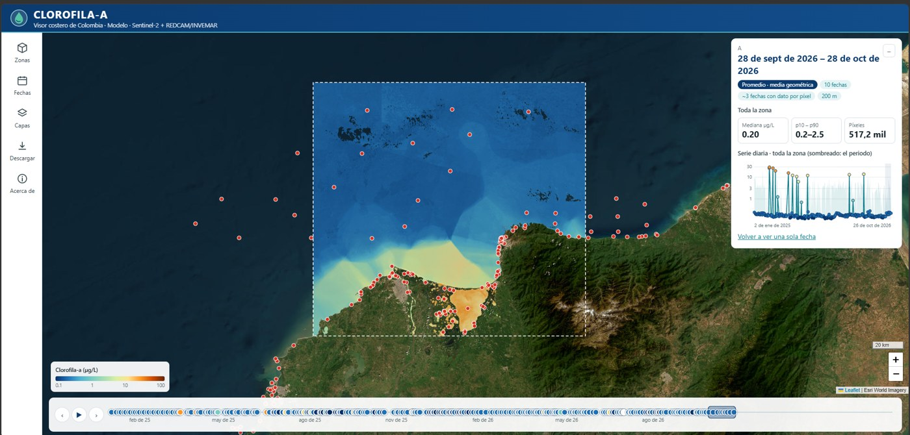
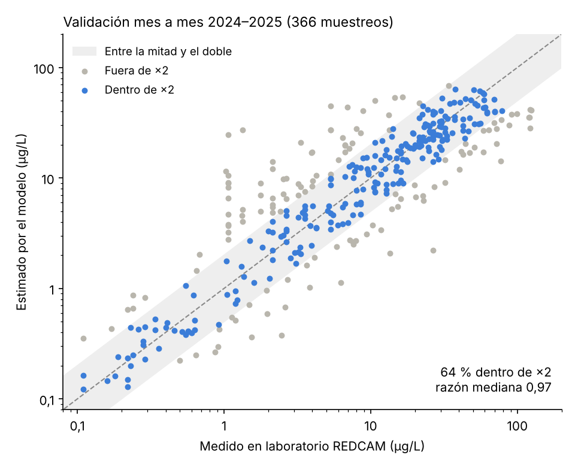
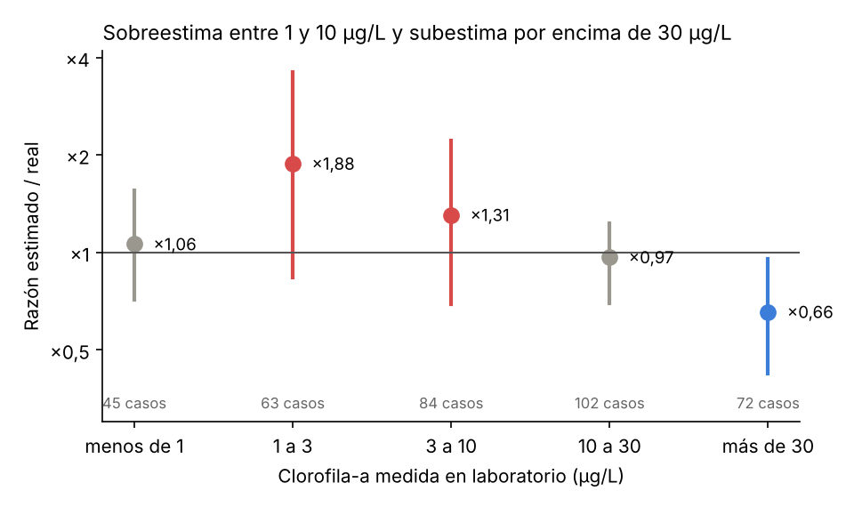

# Clorofila-a costera de Colombia con Sentinel-2 y REDCAM




Este repositorio tiene el código del modelo que estima la concentración de clorofila-a (µg/L) en aguas costeras
de Colombia con imágenes Sentinel-2. El modelo se entrenó con las mediciones de laboratorio de la Red de
Vigilancia para la Conservación y Protección de las Aguas Marinas y Costeras de Colombia (REDCAM) del INVEMAR.
También incluye el visor web que genera mapas de clorofila-a con imágenes nuevas.

Documentación técnica completa: [docs/documentacion_tecnica.md](docs/documentacion_tecnica.md)

## Resumen

- Estima la clorofila-a superficial con píxeles de 20 m en ciénagas, bocas de río, bahías y costa abierta del
  Caribe y el Pacífico.
- Usa un ensamble de tres modelos de árboles (ExtraTrees y dos LightGBM) que combina el color del agua con el
  historial de las estaciones REDCAM, el clima y el caudal de los ríos.
- Aplica una máscara para no confundir la vegetación acuática (*Hydrilla verticillata*) y los techos de los
  pueblos palafíticos con fitoplancton.
- Se validó mes a mes con datos de 2024 y 2025 que el modelo no había visto.

## Resultados

En la validación, para cada mes de 2024–2025 el modelo se reentrenó solo con los datos anteriores y estimó ese mes
(366 muestreos).

| Caso | R² (log10) | Dentro de ×2 | Razón mediana estimado/real |
|---|---|---|---|
| Estaciones REDCAM | 0,75 | 64 % | 0,97 |
| Píxel lejos de las estaciones (simulado) | 0,69 | 57 % | 0,84 |
| Dos muestras de laboratorio de la misma estación tomadas con menos de 1 hora de diferencia | — | 66 % | — |
| NASA MODIS-Aqua (chlor_a, 4 km), mismas muestras | −0,63 a −0,10 | 22–28 % | 0,50–0,72 |

"Dentro de ×2" es el porcentaje de estimaciones que quedaron entre la mitad y el doble del valor del laboratorio.
El error del modelo es parecido a la diferencia que hay entre dos muestras de laboratorio tomadas casi al mismo
tiempo en el mismo sitio, y es mucho menor que el del producto de clorofila-a de MODIS en estas aguas.

<p align="center">
  
  
</p>

El modelo tiende a subir los valores bajos y bajar los muy altos: sobreestima entre 1 y 10 µg/L y subestima por
encima de 30 µg/L.

## Cómo funciona el modelo

El proceso tiene diez partes, desde los datos de campo hasta el mapa. En cada una está el código que la hace y
la explicación de lo que hace. Todo se trabaja con el logaritmo de la clorofila-a (`y = log10(µg/L)`), porque los
valores van de menos de 0,1 a más de 100 µg/L y así un error al doble pesa lo mismo en agua clara que en una
ciénaga.

El código de `clorofila/`, `validar.py` y `entrenar.py` aparece tal como está en el repositorio. Los fragmentos de
`preparacion_datos/` y `visor/` están resumidos y con nombres de variables más largos que en los scripts, para que se
entiendan sin abrir el archivo.

### 1. Datos de campo (REDCAM)

Los datos de partida son 4 443 análisis de clorofila-a de REDCAM entre 2016 y 2025, en 398 estaciones. La función
`load` de [`preparacion_datos/prep.py`](preparacion_datos/prep.py) los lee y los limpia. `registros` es la tabla tal
como viene de REDCAM, con un análisis por fila:

```python
registros = pd.read_csv(ruta_archivo, sep='\t', encoding='utf-8-sig')
for columna in ['latitud', 'longitud']:                       # las coordenadas vienen con coma decimal
    registros[columna] = pd.to_numeric(registros[columna].astype(str).str.replace(',', '.'))
registros['chla'] = registros['concentracion'].astype(float)  # clorofila-a en µg/L
registros['fecha'] = pd.to_datetime(registros['fecha'])

registros = registros[registros.chla <= 1000].copy()          # 15 registros de Antioquia 2020 con error de unidades
registros.loc[registros.chla <= 0, 'chla'] = 0.035            # cero = bajo el límite de detección (0,07) -> la mitad
registros['ambiente'] = registros.apply(ambiente, axis=1)     # tipo de ambiente según el nombre del lugar
```

Cuando una estación tiene varias réplicas el mismo día y a la misma hora, se dejan en una sola fila con la mediana.
`muestreos` es la tabla resultante, con un muestreo por fila:

```python
muestreos = (registros.groupby(['id_estacion', 'fecha'])
             .agg(chla=('chla', 'median'), n_rep=('chla', 'size'), latitud=('latitud', 'first'),
                  longitud=('longitud', 'first'), lugar=('lugar', 'first'), region=('region', 'first'),
                  sector=('sector', 'first'), temporada=('temporada', 'first'), metodo=('metodo', 'first'),
                  ambiente=('ambiente', 'first'))
             .reset_index())

mes = muestreos.fecha.dt.month
muestreos['y'] = np.log10(muestreos['chla'])                  # lo que estima el modelo
muestreos['mes_sin'] = np.sin(2 * np.pi * mes / 12)           # el mes como círculo: diciembre queda junto a enero
muestreos['mes_cos'] = np.cos(2 * np.pi * mes / 12)
muestreos['t'] = (muestreos.fecha - pd.Timestamp('2016-01-01')).dt.days / 365.25   # años desde 2016 (tendencia)
muestreos['metodo_c'] = (muestreos.metodo.str.extract(r'(Lorenzen|Tricomatico|Korolef|Colorimetrico)')[0]
                         .fillna('otro'))                     # método de laboratorio resumido
```

Al final quedan 4 116 muestreos. El tipo de ambiente se asigna con reglas sobre el nombre del lugar, por ejemplo:

```python
def ambiente(registro):
    lugar = normalizar(registro['lugar'])                     # en minúsculas y sin tildes
    if 'cienaga' in lugar or 'cgsm' in lugar or lugar in ('rinconada', 'buenavista', 'tasajera', 'nueva venecia'):
        return 'cienaga_laguna'
    if re.search(r'\b(rio|boca|desembocadura|cano|arroyo)\b', lugar):
        return 'rio_desembocadura'
    if re.search(r'(bahia|puerto|muelle|marina|emisario)', lugar):
        return 'bahia_puerto'
    ...
```

El método de laboratorio se guarda como variable porque el método tricromático no corrige la feofitina y tiende a
dar valores algo mayores que el de Lorenzen.

### 2. Búsqueda de imágenes Sentinel-2

Las imágenes son de Sentinel-2 nivel 2A (reflectancia de superficie corregida con Sen2Cor). Se buscan en el
catálogo STAC de Earth Search (AWS), que es gratuito y no pide cuenta
([`preparacion_datos/sat_extract.py`](preparacion_datos/sat_extract.py)). Primero se piden todas las escenas que
cubren la zona (`zona`, un rectángulo de longitudes y latitudes) entre 3 días antes y 3 días después del muestreo:

```python
def buscar_escenas(zona, fecha_inicio, fecha_fin):
    consulta = {'collections': ['sentinel-2-c1-l2a'], 'bbox': zona,
                'datetime': f'{fecha_inicio}T00:00:00Z/{fecha_fin}T23:59:59Z', 'limit': 100,
                'query': {'eo:cloud_cover': {'lt': 85}}}             # escenas con menos de 85 % de nubes
    respuesta = requests.post('https://earth-search.aws.element84.com/v1/search', json=consulta, timeout=60)
    return respuesta.json()['features']                              # lista de escenas con sus enlaces
```

Luego, para cada muestreo (`muestreo`, una fila de la tabla), se ordenan las escenas que contienen la estación:
primero la más cercana en días y, si empatan, la de menos nubes. Se revisa la ventana de 3 × 3 píxeles alrededor de
la estación en la banda SCL (clasificación de escena) y se acepta la primera escena que tenga al menos 3 píxeles de
agua:

```python
punto_estacion = Point(muestreo.longitud, muestreo.latitud)
candidatas = []
for escena in escenas:
    if not shape(escena['geometry']).contains(punto_estacion):
        continue                                       # la escena no cubre la estación
    fecha_escena = pd.Timestamp(escena['properties']['datetime']).tz_localize(None)
    dias_diferencia = abs((fecha_escena - muestreo.fecha).total_seconds()) / 86400
    nubosidad = escena['properties'].get('eo:cloud_cover', 0)
    candidatas.append((dias_diferencia, nubosidad, escena))
candidatas.sort(key=lambda candidata: (round(candidata[0]), candidata[1]))   # menos días, luego menos nubes

for dias_diferencia, nubosidad, escena in candidatas[:4]:
    clases_scl = leer_ventana(escena['assets']['scl']['href'], crs, muestreo.longitud, muestreo.latitud, radio=1)
    es_agua = np.isin(clases_scl, [6])                 # clase 6 de la SCL = agua
    if es_agua.sum() < 3:
        continue                                       # nube, tierra o sombra: se prueba la siguiente escena
    ...
```

De cada imagen no se descarga la escena completa (cerca de 1 GB) sino solo esa ventana, porque los archivos están en
formato COG y se pueden leer por partes. `radio = 1` da una ventana de 3 × 3 píxeles:

```python
def leer_ventana(enlace_banda, crs, longitud, latitud, radio):
    with rasterio.open(enlace_banda) as imagen:
        x_utm, y_utm = lonlat_a_utm(crs, longitud, latitud)     # coordenadas geográficas -> UTM de la escena
        fila, columna = imagen.index(x_utm, y_utm)              # píxel donde cae la estación
        ventana = Window(columna - radio, fila - radio, 2 * radio + 1, 2 * radio + 1)
        return imagen.read(1, window=ventana).astype(float)
```

Los valores de cada banda (`valores`, la ventana leída) se pasan a reflectancia con la escala y el desplazamiento
que trae la imagen, usando solo los píxeles de agua de la ventana:

```python
escala, desplazamiento, sin_dato = escala_banda(asset)       # escala (0,0001), desplazamiento y valor vacío
valores_agua = valores[es_agua & (valores != sin_dato)]
resultado['s2_' + banda] = float(np.median(valores_agua) * escala + desplazamiento)   # mediana de los píxeles de agua
```

Desde 2022 la ESA aplica un desplazamiento de −0,1 a la reflectancia; el código lo corrige para que las imágenes de
antes y después sean comparables. De los 4 116 muestreos, 1 703 tuvieron una imagen con agua visible; el resto se
perdió sobre todo por nubes.

### 3. Selección de los píxeles de agua

La clasificación de escena de Sentinel-2 marca como agua (clase 6) algunos píxeles que en realidad tienen
vegetación flotante o techos. En la Ciénaga Grande, la planta invasora *Hydrilla verticillata* y los techos de los
pueblos palafíticos reflejan mucho en el infrarrojo, igual que una floración de fitoplancton, y hacían que el
modelo sobreestimara. Por eso, además de la banda SCL, se revisa el NDVI: el agua libre tiene NDVI negativo, y un
píxel con NDVI positivo y B8A/B05 mayor que 1,2 se marca como vegetación o techo
([`visor/clorofila_core.py`](visor/clorofila_core.py), función `variables_espectrales`). Aquí `bandas` tiene la
reflectancia de cada banda en toda la imagen y `variables` guarda lo que se le pasa al modelo:

```python
es_agua = clases_scl == 6                                                  # clase 6 de la SCL = agua
bandas_agua = {banda: np.where(es_agua, bandas[banda], np.nan) for banda in BANDAS}    # se borra lo que no es agua
mediana_3x3 = {banda: mediana_ventana(bandas_agua[banda], 3) for banda in BANDAS}      # mediana 3x3 de los píxeles de agua
...
rojo, borde_rojo, infrarrojo = (np.clip(mediana_3x3[banda], 0.001, None) for banda in ['B04', 'B05', 'B8A'])
variables['NDVI'] = (infrarrojo - rojo) / (infrarrojo + rojo)
variables['r85'] = infrarrojo / borde_rojo
vegetacion_o_techo = (variables['NDVI'] > 0) & (variables['r85'] > 1.2)
pixeles_validos = es_agua & np.isfinite(variables['B04']) & ~vegetacion_o_techo   # píxeles que sí se estiman
```

En el entrenamiento, a los muestreos que caen sobre vegetación se les borran las variables del satélite (quedan
vacías) para que el modelo se apoye en el historial de la estación:

```python
muestreos['macro'] = ((muestreos.NDVI > 0) & (muestreos.r85 > 1.2)).astype(int)   # 1 = vegetación o techo
muestreos.loc[muestreos.macro == 1, variables_satelitales] = np.nan
```

Además, para 231 muestreos que caían sobre vegetación o techos se buscó en la misma imagen la ventana 3 × 3 de agua
limpia más cercana, a máximo 500 m
([`preparacion_datos/navegador/pixel_agua_limpia_navegador.js`](preparacion_datos/navegador/pixel_agua_limpia_navegador.js)).
Se encontró en 102 casos, a una distancia mediana de 111 m, y esas muestras usan el color de ese píxel.

### 4. Variables espectrales

Con las bandas B02 (492 nm), B03 (560 nm), B04 (665 nm), B05 (705 nm) y B8A (865 nm) se calculan los índices que se
relacionan con la clorofila-a. El fitoplancton absorbe la luz roja (B04) y refleja más en el borde rojo (B05), así
que el NDCI sube cuando hay más clorofila. La altura del pico del borde rojo (FLH) mide cuánto sobresale B05 de la
línea que une B04 y B8A:

```python
azul, verde, rojo, borde_rojo, infrarrojo = (np.clip(mediana_3x3[banda], 0.001, None)   # evita dividir por cero
                                             for banda in ['B02', 'B03', 'B04', 'B05', 'B8A'])

variables['NDCI'] = (borde_rojo - rojo) / (borde_rojo + rojo)
variables['FLH'] = borde_rojo - (rojo + (infrarrojo - rojo) * (705 - 665) / (865 - 665))
variables['r54'] = np.log(borde_rojo / rojo)      # borde rojo / rojo
variables['r32'] = np.log(verde / azul)           # verde / azul
variables['r42'] = np.log(rojo / azul)            # rojo / azul
variables['r53'] = np.log(borde_rojo / verde)     # borde rojo / verde
```

También se guardan medidas de calidad del píxel. Si la ventana es muy variable o tiene pocos píxeles de agua, el
dato es menos confiable, y el modelo lo tiene en cuenta:

```python
mediana_5x5 = {banda: mediana_ventana(bandas_agua[banda], 5) for banda in BANDAS}
variables['NDCI5'] = (mediana_5x5['B05'] - mediana_5x5['B04']) / (mediana_5x5['B05'] + mediana_5x5['B04'])  # NDCI en 5x5
variables['cv_med'] = np.nanmedian(np.stack([coef_variacion(bandas_agua[banda], 5)        # qué tan distintos son
                                             for banda in ['B03', 'B04', 'B05']]), 0)       # los píxeles de la ventana
variables['qc_nw5'] = np.nansum(ventanas(es_agua.astype(float), 5), axis=(-1, -2))     # píxeles de agua en 5x5
variables['s2_nubes'] = np.full(es_agua.shape, float(nubosidad_escena))                # nubosidad de la escena
```

En el infrarrojo de onda corta (B11, 1 610 nm, y B12, 2 190 nm) el agua es casi negra, así que lo que se ve ahí es
brillo del sol o aerosol que quedó después de la corrección atmosférica. Con la forma en que cambia entre B11 y B12
se estima cuánto de ese brillo hay en cada banda y se resta. `swir_1610` y `swir_2190` son la reflectancia de B11 y
B12, `variables[banda]` es la mediana 3 × 3 de cada banda y `LONGITUD_ONDA` tiene la longitud de onda central de cada banda:

```python
pendiente = np.clip(np.log(swir_1610 / swir_2190) / np.log(2190 / 1610), 0, 2)    # cómo cae el brillo con la longitud de onda
corregidas = {}
for banda, longitud in LONGITUD_ONDA.items():                                      # {'B02': 492, 'B03': 560, ...}
    brillo = swir_1610 * (longitud / 1610) ** (-pendiente)                           # brillo estimado en esa banda
    variables[banda + '_ce'] = variables[banda] - brillo                             # banda corregida
    corregidas[banda] = np.clip(variables[banda + '_ce'], 0.001, None)
variables['c_NDCI'] = (corregidas['B05'] - corregidas['B04']) / (corregidas['B05'] + corregidas['B04'])
...                                                                                # igual con r54, r32, r42, r53 y FLH
```

La última variable espectral (`gl_ce`) es una estimación hecha con GLORIA, una base mundial de espectros de agua
medidos en campo junto con su clorofila-a (4 675 espectros usables, de unos 450 cuerpos de agua). Cada espectro viene
cada 1 nm entre 350 y 900 nm; se convierte a las bandas de Sentinel-2 promediándolo con la forma de cada banda, y con
eso se entrena un LightGBM ([`preparacion_datos/gloria.py`](preparacion_datos/gloria.py)):

```python
longitudes = np.arange(350, 901)                                          # nm
espectros = gloria[[f'Rrs_{longitud}' for longitud in longitudes]].values             # un espectro por fila

def banda_simulada(centro, ancho):
    """Simula una banda de Sentinel-2 como una campana con ese centro y ese ancho (nm)."""
    pesos = np.exp(-0.5 * ((longitudes - centro) / (ancho / 2.355)) ** 2)
    pesos /= pesos.sum()
    return np.nansum(espectros * pesos, axis=1)                           # promedio ponderado de cada espectro

BANDAS_S2 = {'B02': (492.4, 66), 'B03': (559.8, 36), 'B04': (664.6, 31), 'B05': (704.1, 15), 'B8A': (864.8, 21)}
for banda, (centro, ancho) in BANDAS_S2.items():
    gloria[banda] = np.pi * banda_simulada(centro, ancho)                 # reflectancia = π · Rrs
gloria['y'] = np.log10(gloria.Chla)
modelo_gloria = nuevo_lightgbm().fit(indices_espectrales(gloria), gloria.y)   # NDCI, cocientes y FLH
```

Ese modelo se aplica a las bandas corregidas de cada píxel. En su propia validación con GLORIA tuvo R² de 0,81,
pero en las aguas colombianas sobreestima unas 2,5 veces, así que entra como una pista más y no como la respuesta.

### 5. Variables de las estaciones

El satélite dice cómo se ve el agua ese día, pero no el nivel normal del sitio: una ciénaga suele tener mucha más
clorofila que la costa de San Andrés. Esto se calcula con las mediciones REDCAM en
[`clorofila/contexto.py`](clorofila/contexto.py). `entrenamiento` son los muestreos con los que se entrena y `tabla`
es la tabla a la que se le agregan las variables (la misma de entrenamiento o la de los muestreos a estimar).

Las **estaciones vecinas** se buscan con un árbol de distancias sobre la esfera (haversine). Se toman las 6 más
cercanas, se descarta la propia estación y se promedian sus valores con un peso que baja con la distancia:

```python
estaciones = entrenamiento.groupby('id_estacion').agg(y=('y', 'mean'), lat=('latitud', 'first'), lon=('longitud', 'first'))
arbol_distancias = BallTree(np.radians(estaciones[['lat', 'lon']].values), metric='haversine')

distancias, indices = arbol_distancias.query(np.radians(tabla[['latitud', 'longitud']].values),
                                             k=min(6, len(estaciones)))      # las 6 estaciones más cercanas
distancias_km = distancias * RADIO_TIERRA_KM                                  # el árbol devuelve radianes
es_propia = estaciones.index.values[indices] == tabla.id_estacion.values[:, None]
pesos = 1 / (distancias_km + 1.0)                                             # peso = 1 / (km + 1)
pesos[es_propia] = 0                                                          # la estación no se cuenta a sí misma
tabla['vec_mean'] = (pesos * estaciones.y.values[indices]).sum(1) / pesos.sum(1)            # promedio de las vecinas
tabla['vec_dist'] = np.log1p(np.where(es_propia, np.inf, distancias_km).min(1))            # distancia a la más cercana
```

El **historial** es el promedio de la estación y el promedio en la misma temporada. Al entrenar, el promedio de
cada muestra se calcula sin ella misma (si no, el modelo estaría viendo la respuesta):

```python
suma_y_conteo = entrenamiento.groupby('id_estacion').y.agg(['sum', 'count'])   # por estación
de_su_estacion = suma_y_conteo.loc[tabla.id_estacion]                          # la fila de la estación de cada muestra
tabla['hist_n'] = de_su_estacion['count'].values - 1                            # cuántas muestras tiene, sin esta
tabla['hist_est'] = ((de_su_estacion['sum'].values - tabla.y.values)            # promedio sin la propia muestra
                     / (de_su_estacion['count'].values - 1).clip(1))
tabla.loc[tabla.hist_n == 0, 'hist_est'] = np.nan
tabla['hist_est'] = tabla['hist_est'].fillna(tabla['vec_mean'])                 # estación sin historia -> vecinas
```

La **última medición** de la estación y del sector se calcula corriendo la serie una posición, así cada muestra
solo ve las anteriores:

```python
entrenamiento = entrenamiento.sort_values('fecha')
for columna, sufijo in (('id_estacion', 'est'), ('sector', 'sec')):
    grupos = entrenamiento.groupby(columna)
    entrenamiento[f'ult_{sufijo}'] = grupos.y.shift(1)                                   # valor anterior
    entrenamiento[f'dias_{sufijo}'] = (entrenamiento.fecha - grupos.fecha.shift(1)).dt.days   # días desde ese valor
    entrenamiento[f'm3_{sufijo}'] = grupos.y.transform(                                  # promedio de las 3 anteriores
        lambda serie: serie.shift(1).rolling(3, min_periods=1).mean())
    entrenamiento[f'sd6_{sufijo}'] = grupos.y.transform(                                 # variación de las 6 anteriores
        lambda serie: serie.shift(1).rolling(6, min_periods=2).std())
```

Para estimar una fecha nueva se usa todo lo que haya antes de esa fecha (función `ultima_medicion_prediccion`).

### 6. Clima y caudal de los ríos

La lluvia y los ríos traen nutrientes y sedimentos que cambian la clorofila de un día a otro. Para cada fecha se
descarga el clima diario de NASA POWER en el punto ([`visor/fuentes.py`](visor/fuentes.py), función `hidroclima`)
y se calculan acumulados y promedios de los días anteriores:

```python
url = ('https://power.larc.nasa.gov/api/temporal/daily/point?parameters=PRECTOTCORR,WS10M_MAX,WD10M,ALLSKY_SFC_SW_DWN,T2M'
       f'&community=RE&longitude={longitud}&latitude={latitud}&start={fecha_inicio}&end={fecha_fin}&format=JSON')
clima = pd.DataFrame(requests.get(url).json()['properties']['parameter'])   # una fila por día

for dias in (3, 7, 30, 90):
    variables_clima[f'lluvia_{dias}d'] = clima.PRECTOTCORR.rolling(dias, min_periods=1).sum()   # lluvia acumulada
for dias in (3, 7):
    variables_clima[f'viento_{dias}d'] = clima.WS10M_MAX.rolling(dias, min_periods=1).mean()    # viento máximo promedio
variables_clima['rad_7d'] = clima.ALLSKY_SFC_SW_DWN.rolling(7, min_periods=1).mean()           # radiación solar
variables_clima['t2m_7d'] = clima.T2M.rolling(7, min_periods=1).mean()                         # temperatura del aire
```

El caudal de seis ríos (Magdalena, Sevilla, Aracataca, Atrato, Patía y Ranchería) viene de GloFAS. Se usa en
logaritmo, como promedio de 30 días y como anomalía frente a lo normal para esa época del año. `respuesta` es lo que
devuelve la consulta de GloFAS para un río y `clim_rios` tiene el caudal normal de cada río por día del año:

```python
caudal = pd.Series(respuesta['daily']['river_discharge'], index=pd.to_datetime(respuesta['daily']['time']))  # m³/s
caudal_normal = pd.Series(np.array(clim_rios[rio]['doy'])[caudal.index.dayofyear - 1], index=caudal.index)
caudal_30d = caudal.rolling(30, min_periods=1).mean()
normal_30d = caudal_normal.rolling(30, min_periods=1).mean()
variables_rio[f'q_{rio}'] = float(np.log10(caudal.iloc[-1]))                              # caudal del día
variables_rio[f'q_{rio}_30d'] = float(np.log10(caudal_30d.iloc[-1]))                      # promedio de 30 días
variables_rio[f'q_{rio}_anom'] = float(np.log10(caudal_30d.iloc[-1] / normal_30d.iloc[-1]))  # más o menos agua que lo normal
```

En total el modelo usa 82 variables numéricas y 5 categóricas (tipo de ambiente, región, departamento, temporada y
método de laboratorio). La lista completa, por grupos, está en [`clorofila/variables.py`](clorofila/variables.py).

### 7. Entrenamiento

Antes de entrenar, la tabla se convierte en números ([`clorofila/modelo.py`](clorofila/modelo.py), función
`matriz`). Cada categoría pasa a una columna de 0 y 1 (por ejemplo `ambiente_cienaga_laguna`), y los datos que
faltan se marcan con −9, un valor que no aparece en ninguna variable, para que los árboles los traten aparte:

```python
def matriz(tabla, columnas=None):
    tabla_numerica = pd.get_dummies(tabla[CATEGORICAS + NUMERICAS], columns=CATEGORICAS, dtype=float)
    tabla_numerica.columns = [re.sub(r'[^A-Za-z0-9_]', '_', nombre) for nombre in tabla_numerica.columns]
    tabla_numerica = tabla_numerica.fillna(-9)
    if columnas is None:
        return tabla_numerica
    return tabla_numerica.reindex(columns=columnas, fill_value=0)    # mismas columnas que al entrenar
```

Con esa tabla (109 columnas) se entrenan tres modelos de árboles de decisión. Un árbol hace preguntas del tipo
"¿el NDCI es mayor que 0,05?" o "¿el historial de la estación es mayor que 10 µg/L?" hasta llegar a un valor:

```python
def extra_trees():
    return ExtraTreesRegressor(n_estimators=250, min_samples_leaf=1, max_features=0.53, n_jobs=-1, random_state=0)

def lightgbm_cuantil(alpha):
    return lgb.LGBMRegressor(objective='quantile', alpha=alpha, n_estimators=686, learning_rate=0.01144,
                             num_leaves=48, min_child_samples=5, subsample=0.606, subsample_freq=1,
                             colsample_bytree=0.601, reg_lambda=0.0443, verbose=-1, random_state=0)

def entrenar(entrenamiento):
    entradas = matriz(entrenamiento)                    # 109 columnas
    return {'et': extra_trees().fit(entradas, entrenamiento.y),
            'lgb50': lightgbm_cuantil(0.5).fit(entradas, entrenamiento.y),
            'lgb40': lightgbm_cuantil(0.4).fit(entradas, entrenamiento.y),
            'cols': list(entradas.columns)}            # se guardan para armar igual la tabla al estimar
```

| Modelo | Cómo trabaja | Por qué está |
|---|---|---|
| ExtraTrees | 250 árboles independientes; en cada división prueba el 53 % de las variables con umbrales al azar | Es estable con pocos datos |
| LightGBM, cuantil 0,5 | 686 árboles en cadena; cada uno corrige el error de los anteriores. Estima la mediana | Capta relaciones que los árboles independientes no ven |
| LightGBM, cuantil 0,4 | Igual, pero quedarse por encima le cuesta 0,6 y quedarse por debajo 0,4 | Se agregó porque las primeras versiones sobreestimaban en la Ciénaga Grande |

Los hiperparámetros se afinaron con Optuna. También se probaron Ridge, Random Forest, HistGradientBoosting y
XGBoost; ExtraTrees, XGBoost y LightGBM quedaron casi empatados, y se escogió uno de cada familia porque se
equivocan de forma distinta y al promediarlos el error baja.

El entrenamiento final ([`entrenar.py`](entrenar.py)) usa los 1 703 muestreos con imagen:

```python
tabla = cargar_tabla()                                               # los 4 116 muestreos
entrenamiento, _ = contexto_espacial(tabla, tabla.iloc[:3])          # vecinos e historial (paso 5)
entrenamiento = con_imagen(entrenamiento).join(ultima_medicion_entrenamiento(tabla)[ULTIMA_MEDICION])
modelos = entrenar(entrenamiento)
...
joblib.dump(paquete, ruta_visor, compress=3)                         # visor/modelo/modelo_clorofila.joblib
```

### 8. Validación

El modelo se evaluó mes a mes ([`validar.py`](validar.py)). Para cada mes de 2024–2025 se reentrena solo con los
datos anteriores a ese mes y se estiman las muestras de ese mes, como pasaría si se usara en la práctica:

```python
tabla = cargar_tabla()
muestras_prueba = con_imagen(tabla[tabla.anio >= 2024])
estimaciones = []
for mes, muestras_del_mes in muestras_prueba.groupby(muestras_prueba.fecha.dt.to_period('M')):
    historial = tabla[tabla.fecha < mes.start_time]                              # solo lo anterior a ese mes
    entrenamiento, a_estimar = contexto_espacial(historial, muestras_del_mes)    # vecinos e historial con el pasado
    entrenamiento = con_imagen(entrenamiento).join(ultima_medicion_entrenamiento(historial)[ULTIMA_MEDICION])
    a_estimar = ultima_medicion_prediccion(historial, a_estimar)
    modelos = entrenar(entrenamiento)
    estimaciones.append(pd.Series(predecir(modelos, a_estimar), index=a_estimar.index))
```

Las métricas ([`clorofila/metricas.py`](clorofila/metricas.py)) se calculan en logaritmo o en términos relativos,
porque un error de 5 µg/L es poco en la Ciénaga Grande y muchísimo en San Andrés:

```python
def metricas(medido_log, estimado_log):                     # ambos en log10(µg/L)
    medido, estimado = 10 ** medido_log, 10 ** estimado_log
    razon = estimado / medido                               # 1 = exacto, 2 = el doble, 0,5 = la mitad
    return {'R2_log': 1 - np.sum((medido_log - estimado_log) ** 2) / np.sum((medido_log - medido_log.mean()) ** 2),
            'MdSA_pct': 100 * (np.exp(np.median(np.abs(np.log(razon)))) - 1),     # error relativo típico
            'Dentro_x2_pct': 100 * np.mean((razon >= 0.5) & (razon <= 2)),         # entre la mitad y el doble
            'Razon_mediana': np.median(razon), ...}
```

Con `python validar.py --sin-estacion` se repite la validación borrando el historial y la última medición de la
estación, para simular un píxel lejos de las estaciones.

### 9. Predicción y ajuste de extremos

La estimación es el promedio de los tres modelos en log10, que equivale a la media geométrica en µg/L. De
ExtraTrees se toma la mediana de sus 250 árboles en vez del promedio, para que un árbol extremo no arrastre el
resultado:

```python
def predecir(modelos, a_estimar):
    entradas = matriz(a_estimar, modelos['cols'])
    respuestas_arboles = np.stack([arbol.predict(entradas.values) for arbol in modelos['et'].estimators_])
    estimacion_et = np.median(respuestas_arboles, 0)          # mediana de los 250 árboles
    estimacion_lgb50 = modelos['lgb50'].predict(entradas)
    estimacion_lgb40 = modelos['lgb40'].predict(entradas)
    return (estimacion_et + estimacion_lgb50 + estimacion_lgb40) / 3
```

Los modelos de árboles acercan las estimaciones al promedio: suben los valores bajos y bajan los altos, porque cada
hoja de un árbol devuelve el promedio de varias muestras. En la validación las estimaciones estaban un 15 % menos
dispersas que las mediciones. Para corregirlo, cada estimación se aleja de un centro (c) en un factor (k):

```python
def parametros_ajuste(medido_log, estimado_log, factor_min=1.0, factor_max=1.4):
    centro = float(np.mean(estimado_log))                                  # promedio de las estimaciones
    factor = float(np.clip(np.std(medido_log) / np.std(estimado_log),      # cuánto más dispersas están las mediciones
                           factor_min, factor_max))
    return centro, factor

def ajuste_extremos(estimado_log, centro, factor):
    return centro + factor * (np.asarray(estimado_log) - centro)
```

Con los datos de 2024–2025, el centro es c = 0,8698 (7,4 µg/L) y el factor k = 1,1516; están guardados en
[`modelo/ajuste_extremos.json`](modelo/ajuste_extremos.json). El factor se limita entre 1 y 1,4 para que el ajuste
nunca comprima más las estimaciones ni exagere los extremos.

Por ejemplo, en la Ciénaga la Luna (12 de agosto de 2024) el laboratorio midió 33,4 µg/L. Los tres modelos dieron
26,7, 29,6 y 29,1 µg/L; el promedio fue 28,4 µg/L (15 % por debajo) y con el ajuste quedó en 34,9 µg/L (4 % por
encima). El ajuste no siempre ayuda, porque también empuja valores que ya estaban bien.

### 10. Mapas en el visor

El visor ([`visor/`](visor/)) aplica todo lo anterior a cada píxel de una imagen nueva. Primero busca las escenas de
la zona y la fecha en Earth Search y las agrupa por día, porque una zona grande puede necesitar varias teselas
([`visor/fuentes.py`](visor/fuentes.py)). `poligono` es la zona que el usuario dibuja en el mapa:

```python
def buscar_escenas(poligono, fecha, dias=10, nubes_max=70):
    consulta = {'collections': ['sentinel-2-l2a'], 'intersects': poligono, 'limit': 100,
                'datetime': f'{fecha_inicio}T00:00:00Z/{fecha_fin}T23:59:59Z',   # fecha ± dias
                'query': {'eo:cloud_cover': {'lt': nubes_max}}}
    ...
    escenas['dia'] = escenas.fecha.dt.normalize()            # teselas del mismo paso del satélite -> un mosaico
    return escenas.groupby('dia').agg(fecha=('fecha', 'min'), nubes=('nubes', 'mean'), items=('item', list))
```

Después lee solo el recorte del polígono de cada banda (`leer_recorte`), calcula las variables espectrales y la
máscara (pasos 3 y 4) y estima con el contexto de las estaciones cercanas
([`visor/clorofila_core.py`](visor/clorofila_core.py), función `estimar_mapa`). `indices_agua` son las posiciones
de los píxeles válidos, y `pesos` tiene, para cada píxel, el peso de cada una de sus 4 estaciones más cercanas:

```python
variables, pixeles_validos, vegetacion_o_techo = variables_espectrales(bandas, clases_scl, nubosidad, paquete['gloria'])
indices_agua = np.where(pixeles_validos.ravel())[0]
latitudes, longitudes = lat.ravel()[indices_agua], lon.ravel()[indices_agua]
contextos = [contexto(latitudes, longitudes, fecha, paquete['muestras'], rank=orden)   # paso 5 con la 1.ª, 2.ª,
             for orden in range(4)]                                                    # 3.ª y 4.ª estación más cercana
suma_ponderada = np.zeros(len(indices_agua))
for orden, contexto_estacion in enumerate(contextos):
    entradas = contexto_estacion.copy()
    for nombre, valores in variables.items():
        entradas[nombre] = valores.ravel()[indices_agua]       # variables del satélite de cada píxel
    for nombre, valor in hidroclima.items():
        entradas[nombre] = valor                               # clima y caudales del día (paso 6)
    suma_ponderada += pesos[:, orden] * predecir(paquete, entradas)   # pasos 7 y 9
mapa_chla[indices_agua] = 10 ** (suma_ponderada / pesos.sum(1))      # de log10 a µg/L
```

Cada píxel se estima con el contexto de las 4 estaciones más cercanas y se promedia con pesos que bajan con la
distancia; así no se ven bordes rectos donde cambia la estación más cercana. Si el píxel está a menos de 150 m de
una estación, se usa el historial de esa estación. El agua a más de 12 km de una estación REDCAM se marca como de
menor confianza. El mapa se guarda en GeoTIFF (µg/L) y en PNG.

## Limitaciones

- **Valores extremos.** Aunque se aplica el ajuste de extremos, el modelo sigue sobreestimando los valores bajos y
  subestimando los muy altos (razón mediana de 1,28 en valores menores de 5,3 µg/L y de 0,68 en mayores de 29 µg/L).
  En los mapas, un valor muy alto probablemente es aún mayor y uno muy bajo, aún menor.
- **Lejos de las estaciones.** La variable que más pesa es el historial de las estaciones REDCAM. Donde no hay
  estaciones cerca el desempeño baja (R² de 0,69 y razón de 0,84, es decir, se queda corto), por eso el visor marca
  como de menor confianza el agua a más de 12 km de una estación.
- **Pueblos palafíticos.** En Nueva Venecia y Buenavista los techos ocupan casi todo el píxel de 20 m y la razón
  sigue cerca de 1,3.
- **Nubes.** Solo el 41 % de los muestreos tuvo una imagen con agua visible a ±3 días. En los mapas de una sola fecha
  suelen quedar huecos; el visor permite promediar varias fechas de un periodo.
- **Precisión del dato de campo.** Dos muestras de la misma estación tomadas con menos de una hora de diferencia
  coinciden dentro de ×2 solo el 66 % de las veces. Ese margen limita cuánto se puede acercar cualquier modelo a
  una medición individual.
- **Otras regiones.** El modelo aprendió la relación entre el color del agua y la clorofila-a de las aguas costeras
  colombianas y depende de la red REDCAM, así que no se puede aplicar directamente en otro país ni en mar abierto.
  Para otra región habría que repetir el proceso con mediciones locales.

## Datos

| Archivo | Contenido |
|---|---|
| `datos/redcam_clorofila_a_800.csv` | Mediciones originales de clorofila-a de REDCAM (SIAM, metodología 800): 4 443 registros, 398 estaciones, 2016–2025 |
| `datos/tabla_modelo.csv.gz` | Tabla lista para el modelo: un muestreo por fila (4 116) con sus variables satelitales, de calidad e hidroclimáticas |

Columnas principales de `tabla_modelo.csv.gz`:

| Columnas | Descripción |
|---|---|
| `id_estacion`, `fecha`, `latitud`, `longitud`, `lugar`, `sector` | Identificación del muestreo |
| `y`, `chla` | log10 de la clorofila-a y clorofila-a en µg/L |
| `ambiente`, `region`, `departamento`, `temporada`, `metodo_c` | Categóricas |
| `s2` | `True` si el muestreo tiene imagen Sentinel-2 de agua a ±3 días (1 703 muestreos) |
| `B02` … `B12`, `NDCI`, `FLH`, `r54`, … | Variables espectrales (vacías donde hay vegetación o techos) |
| `NDCI5`, `cv_med`, `qc_nw5`, `s2_nubes`, … | Calidad del píxel |
| `lluvia_*`, `viento_*`, `rad_7d`, `t2m_7d`, `q_*` | Clima y caudales |
| `macro`, `pix_movido`, `NDVI`, `r85` | Máscara de vegetación y píxel de agua limpia |

Los muestreos sin imagen (`s2 = False`) no se usan para entrenar, pero sí para el historial de las estaciones.
Los scripts con los que se armó la tabla están en [`preparacion_datos/`](preparacion_datos/).

## Estructura del proyecto

```
clorofila-a-colombia/
├── clorofila/                  # Código del modelo
│   ├── variables.py            # Lista de variables por grupo
│   ├── datos.py                # Lectura de la tabla
│   ├── contexto.py             # Vecinos, historial y última medición
│   ├── modelo.py               # Ensamble y ajuste de extremos
│   └── metricas.py             # Métricas de evaluación
├── validar.py                  # Validación mes a mes 2024-2025
├── entrenar.py                 # Entrenamiento final
├── modelo/ajuste_extremos.json # Parámetros c y k
├── datos/                      # Datos REDCAM y tabla del modelo
├── preparacion_datos/          # Scripts con los que se armó la tabla
├── visor/                      # Visor web y modelo entrenado
├── resultados/                 # Estimaciones de la validación
├── figuras/                    # Figuras del README
├── docs/                       # Documentación técnica
└── requirements.txt
```
