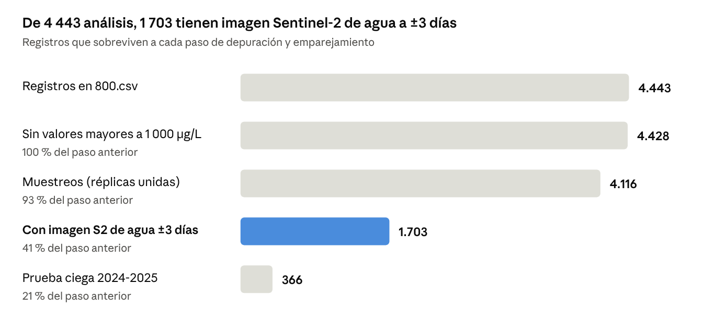
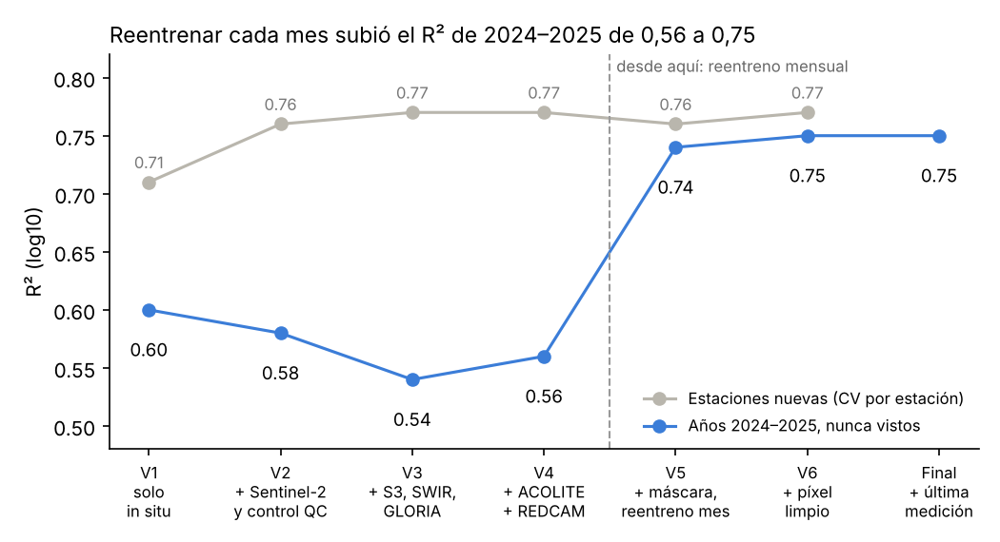
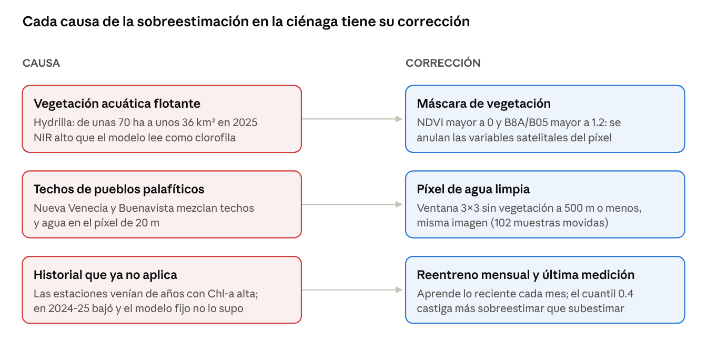
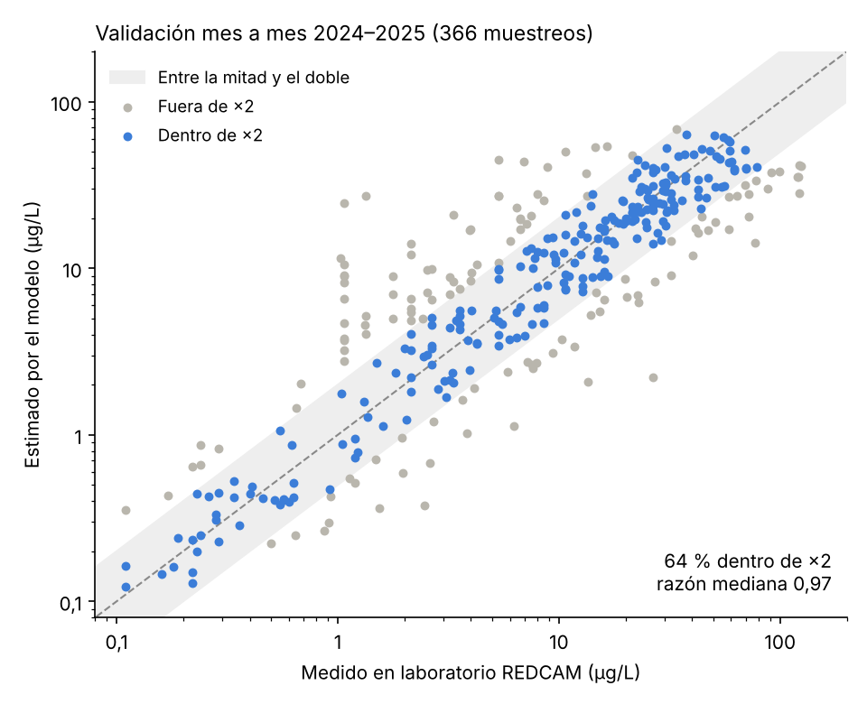
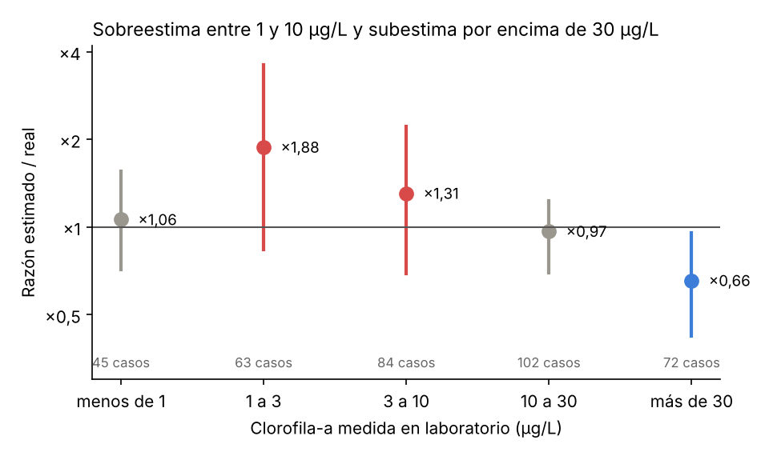
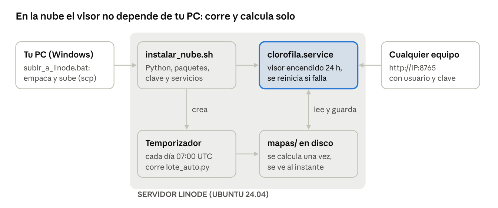

# Estimación de clorofila‑a costera en Colombia con Sentinel‑2 y REDCAM

Jader Andrés Sambony Sarria · Pasantía INVEMAR (LabSIS) · noviembre de 2026

> Este documento describe el desarrollo completo del modelo. Los nombres de scripts que aparecen (`final2.py` … `final6.py`, `exp_lag.py`, `app_train.py`) corresponden a la fase de desarrollo; el código limpio del modelo final está en la carpeta [`clorofila/`](../clorofila/) y en `validar.py` / `entrenar.py`.

## 1. Resumen ejecutivo

El modelo estima la clorofila‑a (Chl‑a) superficial de las aguas costeras de Colombia a partir de Sentinel‑2. En 2024‑2025, con datos que nunca vio, logra R² = 0.747 (en log10), deja el 64 % de las estimaciones dentro de un factor 2 del valor medido y tiene una razón mediana estimado/real de 0.97 (sin sesgo de sobreestimación).

**Objetivo.** Construir un modelo de regresión que estime Chl‑a (µg/L) en cualquier píxel de agua costera, con el menor error posible y sin sobreestimar. El caso crítico fue la Ciénaga Grande de Santa Marta (CGSM).

**Datos de partida.** 4 443 análisis de Chl‑a de la Red de Vigilancia de la Calidad Ambiental Marina (REDCAM, INVEMAR), archivo `800.csv`. Son 398 estaciones entre enero de 2016 y diciembre de 2025: 4 011 en el Caribe, 358 en el Pacífico y 74 mixtos. Tras la depuración quedaron 4 116 muestreos (estación + fecha). De ellos, 1 703 tienen una imagen Sentinel‑2 sin nubes a ±3 días.

**Fuentes añadidas.**

- Sentinel‑2 L2A (Sen2Cor) y L1C corregido con ACOLITE.
- Sentinel‑3 OLCI.
- La base espectral mundial GLORIA.
- Variables fisicoquímicas de la misma REDCAM.
- Clima diario de NASA POWER.
- Caudales de 6 ríos de GloFAS.

**Configuración final.** Combina tres modelos de árboles:

- ExtraTrees.
- LightGBM con pérdida de mediana.
- LightGBM con cuantil 0.4.

Usa 50 a 60 variables:

- Bandas y cocientes espectrales.
- Índice NDCI.
- Máscara de vegetación acuática.
- Píxel de agua limpia más cercano.
- Hidroclima.
- Contexto de la estación y su última medición conocida.

Se reentrena cada mes con todo lo anterior (validación *walk‑forward*). Un ajuste de rango aprendido del pasado corrige la compresión de los extremos.

**Problema resuelto.** En la CGSM el modelo inicial sobreestimaba (razón 1.19, R² −0.16 en 2024‑25). La causa era la invasión de *Hydrilla verticillata* en Pajarales, que se extendió de unas 70 ha a unos 36 km². La planta y los techos de los pueblos palafíticos elevan el infrarrojo, y el historial de la estación arrastraba valores altos. Con la máscara de vegetación, el píxel de agua limpia, el reentrenamiento mensual y la pérdida cuantil, la ciénaga pasó a R² 0.52‑0.55.

**Herramientas entregadas.**

1. Visor local tipo TRITÓN para Windows: zonas, polígonos, línea de tiempo, promedios de periodo, GeoTIFF.
2. Instalador para un servidor en la nube que calcula cada noche.

**Precisión esperada.**

| Situación | R² log10 | Dentro de ×2 | Razón mediana |
| --- | --- | --- | --- |
| Estación REDCAM con historial | 0.747 | 64 % | 0.97 |
| Píxel lejos de estación (visor) | 0.686 | 57 % | 0.84 |
| Repetición de la misma estación ≤ 31 días (techo de ruido) | — | 59 % | — |

El último renglón es la referencia clave: dos muestras reales de la misma estación con menos de un mes de diferencia solo coinciden dentro de ×2 el 59 % de las veces. Ningún modelo satelital puede ser mucho más preciso que eso.

## 2. Fundamento: cómo un satélite “ve” la clorofila‑a

Un satélite no mide clorofila. Mide la luz que sale del agua en varias bandas de color. La Chl‑a se infiere porque el fitoplancton absorbe luz azul (≈443 nm) y roja (≈665 nm) y dispersa algo más en el borde rojo (≈705 nm). Todo modelo satelital de Chl‑a es, en el fondo, una regresión entre esa forma del espectro y mediciones de laboratorio.

### 2.1 De la luz al dato: reflectancia de teledetección

La magnitud física es la reflectancia de teledetección *Rrs*(λ), en sr⁻¹: la radiancia que sale del agua dividida por la irradiancia que llega del sol.

```latex
R_{rs}(\lambda) = \frac{L_w(\lambda)}{E_d(\lambda)}
```

Sentinel‑2 entrega reflectancia de superficie (ρw = π · Rrs). Sobre el mar, entre 90 % y 95 % de la señal que llega al sensor viene de la atmósfera (aire, aerosoles, brillo solar). Por eso la **corrección atmosférica** es el paso más delicado: un error pequeño en la atmósfera es un error grande en el agua.

- **Sen2Cor (L2A)**: la corrección oficial de ESA, pensada para tierra. Sobre agua turbia suele dejar reflectancia de más o de menos en azul y rojo.
- **ACOLITE, ajuste de espectro oscuro (DSF)**: diseñada para agua costera e interior. Estima el aerosol a partir de los píxeles más oscuros de la escena ([Vanhellemont & Ruddick 2018](https://www.vliz.be/imisdocs/publications/343844.pdf); [software, RBINS](https://odnature.naturalsciences.be/remsem/software-and-data/acolite)).

### 2.2 Aguas de caso 1 y caso 2

En mar abierto (caso 1) el color depende casi solo del fitoplancton. Ahí funcionan los algoritmos de cociente azul/verde (OC3/OC4 de NASA). En la costa colombiana (caso 2) el agua también lleva sedimentos del Magdalena, del Atrato y del Sinú, y materia orgánica disuelta coloreada (CDOM) de los manglares. Ambos absorben y dispersan en azul y verde, así que el cociente azul/verde deja de funcionar. Por eso este trabajo se apoya en el **rojo y el borde rojo**, donde el sedimento y el CDOM interfieren menos.

### 2.3 Bandas de Sentinel‑2 usadas

| Banda | Centro (nm) | Resolución | Papel para la Chl‑a |
| --- | --- | --- | --- |
| B02 azul | 492 | 10 m | Absorción de Chl‑a y CDOM |
| B03 verde | 560 | 10 m | Máximo de reflectancia del agua con fitoplancton |
| B04 rojo | 665 | 10 m | Segundo pico de absorción de la Chl‑a |
| B05 borde rojo | 705 | 20 m | Pico de reflectancia que crece con la Chl‑a (agua productiva) |
| B8A NIR | 865 | 20 m | Sedimento, vegetación flotante; casi cero en agua limpia |
| B11 / B12 SWIR | 1610 / 2190 | 20 m | Brillo solar y aerosol residual (el agua es negra aquí) |

Fuente: [ESA, misión Sentinel‑2](https://sentiwiki.copernicus.eu/web/s2-mission).

### 2.4 Índices y algoritmos clásicos

**NDCI** (índice normalizado de diferencia de clorofila) compara el borde rojo con el rojo. Sube cuando hay más Chl‑a porque B04 se absorbe y B05 se refleja ([Mishra & Mishra 2012](https://search.r-project.org/CRAN/refmans/waterquality/html/MM12NDCI.html); [script de Sentinel Hub](https://custom-scripts.sentinel-hub.com/sentinel-2/cyanobacteria_chla_ndci_l1c/)).

```latex
\mathrm{NDCI} = \frac{R_{rs}(705) - R_{rs}(665)}{R_{rs}(705) + R_{rs}(665)}
```

**Modelo de tres bandas** (Gitelson y colaboradores): resta el efecto del sedimento usando el NIR.

```latex
\mathrm{Chl} \propto \left[ R_{rs}^{-1}(665) - R_{rs}^{-1}(705) \right] \cdot R_{rs}(865)
```

**Altura de la línea de fluorescencia o del borde rojo (FLH/MCI)**: cuánto sobresale B05 de la línea recta entre B04 y B8A.

```latex
\mathrm{FLH} = R_{705} - \left[ R_{665} + (R_{865} - R_{665}) \cdot \frac{705-665}{865-665} \right]
```

**Índice de algas flotantes (FAI)** y **NDVI**: detectan vegetación sobre la superficie (macrófitas, *Hydrilla*, buchón). En este trabajo no se usan para estimar Chl‑a sino para **descartar** píxeles: una planta flotante tiene un NIR alto que el modelo confundiría con fitoplancton (sección 7).

Estos índices, cada uno solo, explican entre 30 % y 50 % de la variación en la costa colombiana. El aprendizaje automático los combina con el contexto (lugar, temporada, ríos, historial) y por eso llega a 75 %.

### 2.5 El dato de referencia: Chl‑a de laboratorio

REDCAM mide Chl‑a filtrando agua y extrayendo los pigmentos con acetona. Luego lee la absorbancia en un espectrofotómetro:

- **Método de Lorenzen** (1967): mide antes y después de acidificar, y corrige la feofitina (clorofila degradada). Son 2 231 registros.
- **Método tricromático** (Jeffrey & Humphrey 1975): tres longitudes de onda (630, 647, 664 nm), sin corrección de feofitina. Son 2 195 registros. Tiende a dar valores algo mayores que Lorenzen.

El método entra como variable del modelo, para que aprenda esa diferencia sistemática.

### 2.6 Cómo se mide el error

La Chl‑a se reparte de forma log‑normal: de 0.03 a más de 300 µg/L. Un error de 2 µg/L es enorme en San Andrés (0.2 µg/L) e insignificante en la ciénaga (60 µg/L). Por eso todas las métricas se calculan en log10 y en términos relativos, como recomienda la comunidad de color oceánico ([Seegers et al. 2018](https://pubs.usgs.gov/publication/70265020)).

| Métrica | Qué dice | Ideal |
| --- | --- | --- |
| R² (log10) | Fracción de la variación explicada | 1 |
| MdSA (%) | Error relativo típico, simétrico entre sobre y subestimación | 0 % |
| Razón mediana estimado/real | Sesgo: mayor que 1 sobreestima, menor que 1 subestima | 1.00 |
| % dentro de ×2 | Estimaciones entre la mitad y el doble del valor real | 100 % |
| % dentro de ×1.5 | Ídem, más exigente | 100 % |
| % que sobreestima | Fracción con estimado mayor que real | 50 % |

```latex
\mathrm{MdSA} = 100 \cdot \left( e^{\,\mathrm{mediana}\left| \ln(\hat{y}/y) \right|} - 1 \right)
```

Ejemplo de la razón: si el laboratorio midió 10 µg/L y el modelo dice 13 µg/L, la razón es 1.3 (sobreestima 30 %). Si dice 5 µg/L, la razón es 0.5 (la mitad).

## 3. Fuentes de datos: de dónde sale cada número

Se usaron nueve fuentes, todas públicas salvo la base REDCAM entregada por el usuario. Ninguna requirió cuenta de pago. La tabla resume qué aporta cada una y cómo se leyó; los subapartados dan el detalle.

| Fuente | Qué aporta | Periodo / tamaño | Acceso | Entró al modelo final |
| --- | --- | --- | --- | --- |
| REDCAM / INVEMAR (`800.csv`) | Chl‑a de laboratorio (variable objetivo), lugar, método, temporada | 2016‑2025, 4 443 registros, 398 estaciones | Archivo entregado | Sí (objetivo + contexto) |
| Sentinel‑2 L2A (Sen2Cor) | Reflectancia de 13 bandas a 10‑60 m, máscara SCL | 2016‑hoy, cada 5 días | [Earth Search (AWS), COG](https://registry.opendata.aws/sentinel-2-l2a-cogs/) y GEE | Sí |
| Sentinel‑2 L1C + ACOLITE | Reflectancia del agua con corrección DSF | 44 escenas, 555 emparejamientos | Copernicus / AWS + [ACOLITE](https://odnature.naturalsciences.be/remsem/software-and-data/acolite) | Probado; ganancia pequeña (0.755→0.758) |
| Sentinel‑3 OLCI WFR | Rrs a 300 m, Chl OC4ME y red neuronal | 3 460 emparejamientos | EUMETSAT / Copernicus | No (sin ganancia) |
| GLORIA | 7 572 espectros hiperespectrales con Chl‑a medida, 450 lagos y costas | 4 675 usables | [PANGAEA doi:10.1594/PANGAEA.948492](https://doi.pangaea.de/10.1594/PANGAEA.948492) | Como variable auxiliar |
| REDCAM fisicoquímica (ICAM) | pH, PO₄, NO₃, oxígeno, SST, coliformes | 641 muestreos emparejados | Geovisor REDCAM / INVEMAR | Probado; no en el final |
| NASA POWER | Lluvia, viento, radiación, temperatura diaria a 0.5° | 2015‑2025 | [API NASA POWER](https://power.larc.nasa.gov/) | Sí |
| GloFAS (Copernicus) | Caudal diario de 6 ríos | 2015‑2025 | [Open‑Meteo Flood API](https://open-meteo.com/en/docs/flood-api) | Sí |
| Píxel de agua limpia | Coordenada de agua sin vegetación a ≤ 500 m | 102 muestras movidas | Calculado en GEE | Sí |

### 3.1 REDCAM / INVEMAR

La Red de Vigilancia para la Conservación y Protección de las Aguas Marinas y Costeras de Colombia (REDCAM) es operada por el [INVEMAR](https://www.invemar.org.co/redcam) desde 2001. El archivo `800.csv` contiene la variable “Clorofila a” en agua superficial, con columnas de estación, coordenadas, fecha y hora, proyecto, temporada (seca/lluviosa), región, departamento, sector, concentración (µg/L), método y límite de detección.

- Magdalena aporta 2 589 registros (58 %), casi todos de la Ciénaga Grande de Santa Marta y la bahía de Santa Marta.
- Siguen Atlántico (264), Antioquia (215), Caribe oceánico (195), Córdoba (186) y La Guajira (181).
- La mediana es 5.1 µg/L; el 10 % más bajo está bajo 0.35 µg/L y el 10 % más alto sobre 50.7 µg/L.

### 3.2 Sentinel‑2

Dos satélites gemelos de ESA (2A desde 2015, 2B desde 2017, 2C desde 2024) con el instrumento MSI. Pasan sobre Colombia cerca de las 10:30 hora local. Se leyó de dos formas:

1. **Google Earth Engine**, colección `COPERNICUS/S2_SR_HARMONIZED`, para la extracción masiva inicial (`1_extraer_satelite_gee.py`).
2. **Earth Search de Element 84 en AWS**, recortes COG leídos por HTTP sin descargar la escena (`fuentes.py` del visor). Desde enero de 2022 (procesador 04.00) ESA suma un desplazamiento de −1000 al número digital; Earth Search lo marca con `earthsearch:boa_offset_applied`. El código aplica `DN · escala + desplazamiento` y vuelve a sumar 0.1 cuando el catálogo indica que ya se aplicó, para que las series antes y después de 2022 sean comparables.

La banda **SCL** (clasificación de escena de Sen2Cor) marca agua = 6. Solo se usan píxeles con SCL = 6.

### 3.3 ACOLITE

Se procesaron 44 escenas L1C sobre las estaciones con más muestreos con ACOLITE (DSF, corrección de brillo solar activa). Se obtuvieron 555 emparejamientos y se añadieron como variables `a_B01…a_B12`. Mejoró el error relativo (MdSA 65 % → 58 %) pero apenas el R² (0.755 → 0.758). Como exige descargar la escena completa (≈ 1 GB), no se incluyó en el visor.

### 3.4 Sentinel‑3 OLCI

OLCI tiene 21 bandas, incluidas 681 y 709 nm, ideales para Chl‑a, pero a 300 m. Se emparejaron 3 460 muestras con productos WFR (Chl OC4ME, Chl de red neuronal y Rrs). En la costa colombiana los píxeles de 300 m mezclan agua, manglar y tierra, y la Chl‑a de las ciénagas queda fuera de su rango. Sumar S3 a S2 no mejoró ninguna métrica, así que se descartó.

### 3.5 GLORIA

GLORIA reúne 7 572 mediciones de Rrs hiperespectral (350‑900 nm) con Chl‑a medida a la vez, de 450 cuerpos de agua del mundo ([Lehmann et al. 2023, Scientific Data](https://pmc.ncbi.nlm.nih.gov/articles/PMC9935528)). Se convirtió a bandas de Sentinel‑2 integrando con las funciones de respuesta espectral oficiales, y se entrenó un modelo GLORIA→Chl‑a (R² interno 0.81). Aplicado a Sen2Cor sobreestimaba ×2.5, por la diferencia de corrección atmosférica. Se usó su predicción como una variable más (`gl_*`), no como respuesta final.

### 3.6 Hidroclima

**NASA POWER** (rejilla de 0.5°): lluvia acumulada a 3, 7, 30 y 90 días; viento máximo medio a 3 y 7 días; dirección del viento (seno y coseno) a 7 días; radiación y temperatura del aire a 7 días. La lluvia trae nutrientes y sedimento; el viento mezcla la columna y levanta sedimento; la radiación alimenta al fitoplancton.

**GloFAS** (Global Flood Awareness System, reanalisis v4, leído con Open‑Meteo) en seis ríos: Magdalena en Calamar, Sevilla y Aracataca (que alimentan la CGSM), Atrato, Patía y Ranchera. Para cada uno: log10 del caudal del día, media de 30 días y anomalía frente a la climatología del mismo día del año.

Los datos crudos están en `hidroclima/clima_nasa_power.csv` y `hidroclima/caudales_glofas.csv`; `hidro.py` calcula las 28 variables.

## 4. Depuración de los datos y emparejamiento con el satélite

De los 4 443 análisis de laboratorio quedaron 1 703 muestreos con una imagen Sentinel‑2 de agua utilizable. El 59 % restante se pierde sobre todo por nubes: la costa caribe y pacífica está nublada gran parte del año.



### 4.1 Limpieza de la Chl‑a in situ (`prep.py`)

1. **Valores imposibles.** Se eliminaron 15 registros mayores a 1 000 µg/L, todos de Antioquia en 2020; el máximo llegaba a 592 209 µg/L. Son errores de unidades (probablemente mg/m³ × 1000 o µg en vez de µg/L). Ninguna laguna costera supera unos pocos cientos de µg/L.
2. **Ceros.** Un valor de 0 significa “por debajo del límite de detección” (0.07 µg/L). Se reemplazó por la mitad del límite, 0.035 µg/L, la convención usual en química ambiental. Así el logaritmo no falla.
3. **Réplicas.** Cuando una estación tiene varias muestras en la misma fecha y hora (réplicas o profundidades), se tomó la **mediana**. Quedan 4 116 muestreos únicos.
4. **Escala logarítmica.** La variable objetivo es `y = log10(Chl‑a)`. Así un error de ×2 pesa lo mismo en agua oligotrófica que en la ciénaga.
5. **Tipo de ambiente.** Del nombre del lugar se clasificó cada estación como ciénaga/laguna, río/desembocadura, bahía/puerto, playa o costero. Por ejemplo, “Ciénaga”, “Pajarales” o “Laguna” → ciénaga; “Boca” o “Río” → desembocadura.
6. **Método.** Lorenzen, tricromático, Koroleff o colorimétrico quedaron como categoría.

### 4.2 Emparejamiento (*match‑up*) con Sentinel‑2

Para cada muestreo se buscó la imagen más cercana en el tiempo con estas reglas:

| Regla | Valor | Por qué |
| --- | --- | --- |
| Ventana de tiempo | ±3 días | Estándar en validación de color oceánico; la Chl‑a costera cambia en días |
| Nubosidad de la escena | < 70 % | Más alta casi nunca deja agua visible |
| Píxeles | Solo SCL = 6 (agua) | Excluye nube, sombra, tierra y brillo |
| Ventana espacial | 3×3 píxeles de 20 m (radio de 30 m) y 5×5 para control | Promedia ruido sin salir de la laguna |
| Estadístico | Mediana de la ventana | Robusta ante un píxel contaminado |

Se guardó también la diferencia de días (`s2_dt`), la nubosidad, el número de píxeles de agua y el coeficiente de variación (CV) de la ventana.

### 4.3 Control de calidad del píxel

Se probó el control de calidad clásico de NASA ([Bailey & Werdell 2006](https://oceancolor.gsfc.nasa.gov/images/staff/bailey_and_werdell_2006_rse.pdf)): al menos 50 % de agua en la ventana 5×5 y CV ≤ 0.15. Se aplicó también una variante estricta (≤ 1 día y nubes ≤ 60 %).

| Filtro | Muestreos | R² log10 (in situ + S2) | MdSA |
| --- | --- | --- | --- |
| Sin filtro | 1 703 | 0.755 | 68 % |
| Bailey‑Werdell | 1 209 | 0.735 | — |
| Estricto | 629 | 0.736 | 67 % |

Filtrar **empeoró** el modelo: con menos datos aprende menos. La decisión fue conservar todos los emparejamientos y entregar las medidas de calidad (CV, número de píxeles de agua, días de diferencia) como **variables**. Así el modelo aprende a confiar menos en un píxel ruidoso.

### 4.4 Corrección del resplandor y de la escala

- **Desplazamiento de 2022.** Las reflectancias se homogeneizaron antes y después del cambio de procesador de ESA (ver 3.2).
- **Brillo solar residual.** El agua es negra en el infrarrojo de onda corta (B11, B12). Lo que quede ahí es brillo o aerosol. Se restó a cada banda una corrección proporcional (`B*_cf`) y otra exponencial según la longitud de onda (`B*_ce`), y ambas versiones quedaron disponibles para el modelo.

### 4.5 Píxel de agua limpia

En 231 muestreos el píxel de la estación tenía vegetación o techos (ver sección 7). Un script en GEE (`pixel_agua_limpia_navegador.js`) buscó en la misma imagen la ventana 3×3 de agua sin vegetación más cercana, a 500 m como máximo. Se movieron 102 muestras, a una distancia mediana de 111 m. Las demás no tenían agua limpia cerca y quedaron con las variables satelitales vacías.

## 5. Variables del modelo y por qué está cada una

El modelo usa 82 variables numéricas y 5 categóricas, agrupadas en 11 familias. El satélite dice cómo está el agua hoy. El contexto dice en qué nivel suele estar ese sitio. El hidroclima explica por qué hoy podría ser distinto.

| Familia | Variables | Qué representa |
| --- | --- | --- |
| Espectrales Sentinel‑2 | B02, B03, B04, B05, B8A, B11, B12; log de B04 y B8A; cocientes B05/B04 (`r54`), B03/B02, B04/B02, B05/B03; NDCI; FLH; versiones 5×5 y corregidas de brillo (`c_*`, `*_ce`) | Forma del espectro del agua: absorción en rojo, pico en borde rojo, sedimento en NIR |
| Calidad del píxel | CV 3×3 y 5×5, píxeles de agua en 5×5, nubosidad de la escena | Cuánto fiarse del píxel |
| Máscara de vegetación | NDVI = (B8A−B04)/(B8A+B04); B8A/B05 | Detecta *Hydrilla*, buchón y techos (sección 7) |
| Modelo GLORIA | Chl‑a predicha por el modelo entrenado con GLORIA | Conocimiento de 450 cuerpos de agua del mundo |
| Lugar y fecha | Latitud, longitud, mes (seno y coseno), años desde 2016, hora | Estacionalidad y tendencia de largo plazo |
| Estaciones vecinas | `vec_mean`: media de log Chl‑a de las 6 estaciones más cercanas, ponderada por distancia; `vec_dist`: distancia a la más cercana | Nivel típico de la zona, sirve donde no hay estación |
| Historial de la estación | `hist_est`: media histórica; `hist_est_temp`: media de la misma temporada; `hist_n`: número de muestreos | Nivel habitual del sitio |
| Última medición | Para la estación y para su sector: último valor, días desde él, media de las 3 últimas, desviación de las 6 últimas | Estado reciente; la Chl‑a tiene memoria de semanas |
| Clima | Lluvia 3/7/30/90 d, viento 3/7 d y dirección, radiación y temperatura 7 d | Aporte de nutrientes, mezcla, luz |
| Caudal de ríos | 6 ríos × (caudal del día, media 30 d, anomalía) | Agua dulce, nutrientes y sedimento que llegan a la costa |
| Categorías | Ambiente, región, departamento, temporada, método de laboratorio | Diferencias sistemáticas entre tipos de agua y métodos |

### 5.1 Reglas para no hacer trampa (fuga de información)

Un modelo puede parecer excelente si, sin querer, ve el dato que debe predecir. Se aplicaron tres reglas:

1. **Historial sin la propia muestra.** En entrenamiento, `hist_est` se calcula dejando fuera la muestra actual (*leave‑one‑out*).
2. **Solo el pasado.** Las variables de última medición usan únicamente muestras con fecha anterior a la que se predice.
3. **Contexto solo con entrenamiento.** Vecinos, historial y climatología de ríos se calculan con los datos de entrenamiento de cada partición, nunca con los de prueba.

### 5.2 Qué pesa más


La importancia de un bosque premia variables que separan bien los sitios, como el historial. Pero sin el satélite el modelo no ve el cambio de un día a otro. La prueba directa es quitarlo: el R² cae de 0.755 a 0.690 y el error relativo sube de 68 % a 82 %.

## 6. Modelos, entrenamiento y validación

Se construyeron siete versiones. Agregar fuentes de datos (V2‑V4) subió poco el R². El salto grande vino de **cómo** se entrena (V5): reentrenar cada mes con todo lo anterior hizo que el modelo siguiera los cambios recientes de la ciénaga.

### 6.1 Tres pruebas distintas

Un solo número de precisión puede engañar. Cada versión se evaluó de tres formas, y nunca con datos usados para entrenar.

| Prueba | Cómo se hace | Pregunta que responde |
| --- | --- | --- |
| Estaciones nuevas (*GroupKFold*, 5 grupos) | Las estaciones se reparten en 5 grupos; se entrena con 4 y se predice el quinto. Ninguna estación aparece en ambos lados | ¿Funciona en un sitio donde nunca se ha muestreado? |
| Temporal fija | Entrena con 2016‑2023 y predice 2024‑2025 (366 muestreos) | ¿Aguanta el paso del tiempo sin actualizar? |
| Temporal *walk‑forward* | Para cada mes de 2024‑2025 se entrena con todo lo anterior a ese mes y se predice ese mes. Son 24 reentrenamientos | ¿Cómo funciona en uso real, actualizando cada mes? |

La prueba temporal es la más dura y la más honesta: imita el uso real. La de estaciones nuevas mide cómo funciona el mapa lejos de las estaciones.

### 6.2 Algoritmos probados

Se compararon regresión lineal (Ridge), Random Forest, ExtraTrees, Gradient Boosting (HistGB), XGBoost y LightGBM. Los hiperparámetros se afinaron con [Optuna](https://optuna.org/) (búsqueda bayesiana, `tune.py`) usando la validación por estación. Los modelos de árboles ganaron con claridad a la regresión lineal, porque la relación entre espectro y Chl‑a cambia según el tipo de agua.

- **ExtraTrees** (árboles extremadamente aleatorizados, [Geurts et al. 2006](https://doi.org/10.1007/s10994-006-6226-1)): 250‑400 árboles, 53 % de variables por corte. Muy estable.
- **LightGBM** ([Ke et al. 2017](https://papers.nips.cc/paper/6907-lightgbm-a-highly-efficient-gradient-boosting-decision-tree)): 686 árboles, tasa 0.011, 48 hojas. Captura interacciones finas.
- **XGBoost**: similar a LightGBM; se usó hasta la versión 6.

### 6.3 Pérdida cuantil para no sobreestimar

Un modelo normal minimiza el error cuadrático y apunta a la media. Con la pérdida **cuantil** α = 0.4 el modelo apunta al percentil 40 de los valores posibles. Penaliza más la sobreestimación que la subestimación:

```latex
L_\alpha(y, \hat{y}) = \begin{cases} \alpha \,(y - \hat{y}) & y \ge \hat{y} \\ (1-\alpha)\,(\hat{y} - y) & y < \hat{y} \end{cases}
```

Con α = 0.4, sobreestimar cuesta 0.6 y subestimar 0.4. El modelo promedia tres modelos: la media de los árboles del ExtraTrees, LightGBM con α = 0.5 (mediana) y LightGBM con α = 0.4.

### 6.4 Ajuste de rango

Los modelos de árboles comprimen los extremos: suben los valores bajos y bajan los altos. Para corregirlo, cada mes se compara la dispersión de las predicciones pasadas con la de los valores reales y se estira la predicción alrededor de su centro:

```latex
\hat{y}' = c + k\,(\hat{y} - c), \qquad k = \mathrm{clip}\!\left(\frac{\sigma_{\mathrm{real}}}{\sigma_{\mathrm{pred}}},\ 1,\ 1.4\right)
```

Aquí c es la media de las predicciones pasadas en log10, y k se limita entre 1 y 1.4 para no exagerar. Solo se calcula con meses anteriores (mínimo 40 muestras). En el modelo del visor quedó k = 1.15 y c = 0.87 (7.4 µg/L).

### 6.5 Evolución del modelo (siete versiones)



| Versión | Script | Qué se agregó | Razón mediana 2024‑25 | Dentro de ×2 |
| --- | --- | --- | --- | --- |
| V1 | `model.py` | Solo contexto in situ (lugar, fecha, historial, vecinos) | — | 57 % (CV) |
| V2 | `final2.py` | Bandas e índices S2, variables de calidad, ExtraTrees afinado | 1.03 | 60 % |
| V3 | `final3.py` | Sentinel‑3, corrección SWIR, GLORIA, ensamble ET + XGB + LGB | 1.12 | 61 % |
| V4 | `final4.py` | ACOLITE y fisicoquímica REDCAM | 1.14 | 61 % |
| V5 | `final5.py` | Máscara de macrófitas, hidroclima, cuantil 0.4, reentreno mensual | 0.90 | 64 % |
| V6 | `final6.py` | Píxel de agua limpia | 0.89 | 63 % |
| Final | `exp_lag.py` | Última medición de estación y sector, mediana + cuantil, ajuste de rango | **0.97** | **64 %** |

V3 y V4 subieron la validación por estación pero empeoraron 2024‑2025: sobreestimaban (razón 1.12‑1.14) porque la ciénaga cambió (sección 7). V5 y V6 corrigieron el sesgo pero se pasaron al otro lado (0.89). La versión final quedó centrada (0.97), con MdSA 63 % y 49 % de sobreestimaciones, casi el 50 % ideal.

### 6.6 Entrenamiento del modelo que usa el visor

`app_train.py` entrena la versión final con los 1 703 emparejamientos (2016‑2025): ExtraTrees de 250 árboles más los dos LightGBM, 82 variables numéricas y 5 categóricas. Todo se guarda en `modelo/modelo_clorofila.joblib` junto con:

- los parámetros k y c del ajuste de rango;
- el modelo GLORIA;
- la tabla de muestras REDCAM (para calcular historial y vecinos de cualquier píxel);
- la climatología de los ríos.

En su propia prueba *walk‑forward* obtuvo R² 0.750, 64 % dentro de ×2 y razón 0.97.

## 7. La sobreestimación en la Ciénaga Grande de Santa Marta

En 2024‑2025 la versión 4 sobreestimaba la ciénaga en 19 % y explicaba menos que un promedio constante (R² −0.16). Tras las correcciones, el modelo explica el 54 % de la variación en las 192 muestras de ciénaga. Un 9 % de sobreestimación mediana queda, sobre todo en los pueblos palafíticos.

### 7.1 Diagnóstico

Se agruparon los errores por el NDVI del píxel. En el quinto de muestras con NDVI mayor a 0.24 el modelo sobreestimaba **7.2 veces** en mediana. En agua sin vegetación el error era normal. El agua libre tiene NDVI negativo. Un NDVI positivo en la ciénaga solo puede ser planta flotante, manglar en el borde o techos.

La búsqueda en prensa y fuentes oficiales confirmó la causa principal: la invasión de ***Hydrilla verticillata***, una planta acuática asiática que se extendió desde el sector de Pajarales. Pasó de unas 70 ha a unos 36 km² y en 2025 Minambiente lanzó una estrategia para enfrentarla ([Minambiente](https://www.minambiente.gov.co/minambiente-lidera-estrategia-para-enfrentar-especie-invasora-en-la-cienaga-grande/); [Mongabay, enero 2026](https://es.mongabay.com/2026/01/planta-invasora-colombia-cienaga-grande/); [Cambio, septiembre 2025](https://cambiocolombia.com/medio-ambiente/articulo/2025/9/la-planta-invasora-que-se-esta-tragando-la-cienaga-grande-de-santa-marta-y-poniendo-en-peligro-a-las-comunidades-palafiticas); [AP vía WTOP, mayo 2026](https://wtop.com/asia/2026/05/invasive-plant-threatens-livelihoods-in-colombias-largest-coastal-wetland/)). Las plantas sumergidas y flotantes reflejan mucho en el NIR y en el borde rojo, igual que una floración de fitoplancton. Además, la *Hydrilla* compite por nutrientes y da sombra al fitoplancton, así que la Chl‑a real **bajó** justo cuando la señal satelital **subía**.

El efecto se sumó a un sesgo de historial. Las estaciones de la ciénaga venían de años con Chl‑a alta, y el modelo entrenado hasta 2023 confiaba en esa memoria.



La máscara y el píxel limpio atacan las dos primeras causas a la vez: un techo y una planta dan la misma firma de NIR alto. Se probó también el índice de algas flotantes (FAI, [Hu 2009](https://doi.org/10.1016/j.rse.2009.05.012)); el NDVI con el cociente B8A/B05 separó mejor en Sentinel‑2.

### 7.2 Resultado en la ciénaga (2024‑2025)

| Versión | Qué cambió | R² log10 | Razón mediana |
| --- | --- | --- | --- |
| V4 (entrenado ≤ 2023) | — | −0.16 | 1.19 |
| V5 | Máscara + hidroclima + cuantil + reentreno | 0.51 | — |
| V6 | + píxel limpio | 0.53 | 0.93 |
| Final | + última medición + ajuste de rango | 0.54 | 1.09 |

En los pueblos palafíticos (Nueva Venecia, Buenavista) la razón sigue en 1.3. Ahí los techos ocupan casi todo el píxel de 20 m y no hay agua limpia a menos de 500 m. Para esos puntos la estimación satelital debe tomarse con cautela.

## 8. Resultados finales y ejemplos real vs. estimado

En 2024‑2025, con datos nunca vistos, el modelo pone 2 de cada 3 estimaciones dentro de la mitad y el doble del valor de laboratorio, sin sesgo general (razón 0.97). Su límite es la compresión de extremos: sube un poco los valores muy bajos y baja los muy altos.



### 8.1 Cómo leer la razón estimado/real

La columna “estimado/real” divide la Chl‑a que da el modelo por la que midió el laboratorio. Una razón de 1.00 es acierto exacto. Mayor que 1 es sobreestimación: 1.30 = 30 % por encima. Menor que 1 es subestimación: 0.70 = 30 % por debajo. Entre 0.5 y 2 se considera dentro de ×2, el criterio habitual en color oceánico costero.

### 8.2 Métricas del modelo (2024‑2025, *walk‑forward*)

| Subconjunto | Muestreos | R² log10 | Dentro de ×2 | Razón mediana |
| --- | --- | --- | --- | --- |
| Todos | 366 | 0.747 | 64 % | 0.97 |
| Ciénaga / laguna | 195 | 0.54 | 67 % | 1.08 |
| Río / desembocadura | 91 | 0.59 | 59 % | 0.96 |
| Bahía / puerto | 32 | 0.54 | 53 % | 0.82 |
| Costero | 27 | 0.72 | 70 % | 0.80 |
| Playa | 21 | 0.41 | 71 % | 0.67 |
| Valores bajos (< 5.3 µg/L) | — | — | — | 1.28 |
| Valores altos (> 29 µg/L) | — | — | — | 0.66 |

Otras medidas para todo el conjunto: MdSA 63 %, 44.5 % dentro de ×1.5 y 48.6 % de sobreestimaciones. El R² por subconjunto es más bajo que el general porque cada subconjunto tiene menos rango de valores, no porque el modelo sea peor ahí.

### 8.3 Ejemplos con coordenadas

Un ejemplo por departamento (el más cercano a la razón típica de ese departamento) y varios de la Ciénaga Grande a lo largo de 2024‑2025:

| Fecha | Estación | Departamento | Lat | Lon | Real (µg/L) | Estimado (µg/L) | Estimado/real |
| --- | --- | --- | --- | --- | --- | --- | --- |
| 2025‑08‑26 | Coveñas Puntepiedras | Sucre | 9.419 | −75.650 | 1.05 | 0.88 | 0.83 |
| 2025‑06‑18 | Muelle Manaure ‑ Salina | La Guajira | 11.789 | −72.441 | 0.57 | 0.41 | 0.72 |
| 2025‑05‑05 | Frente hotel Bocana | Valle del Cauca | 3.830 | −77.186 | 5.88 | 2.39 | 0.41 |
| 2025‑04‑02 | Playa Castillogrande | Bolívar | 10.393 | −75.553 | 2.85 | 1.87 | 0.66 |
| 2025‑03‑18 | Boca Caño Clarín | Atlántico | 10.951 | −74.748 | 5.34 | 3.96 | 0.74 |
| 2024‑10‑22 | Playa la Martina | Antioquia | 8.168 | −76.740 | 26.6 | 2.22 | 0.08 |
| 2024‑06‑14 | Frente Sharky’s | San Andrés | 12.501 | −81.732 | 0.18 | 0.16 | 0.90 |
| 2024‑05‑21 | Centro Bahía Cispatá | Córdoba | 9.407 | −75.799 | 5.56 | 4.64 | 0.83 |
| 2025‑11‑11 | Tasajera | Magdalena (CGSM) | 10.976 | −74.329 | 46.3 | 26.4 | 0.57 |
| 2025‑08‑12 | Ciénaga La Redonda | Magdalena (CGSM) | 10.972 | −74.545 | 8.54 | 25.4 | 2.98 |
| 2025‑01‑27 | Ciénaga Pajarales | Magdalena (CGSM) | 10.842 | −74.546 | 13.4 | 15.4 | 1.15 |
| 2024‑10‑21 | Ciénaga la Luna | Magdalena (CGSM) | 10.918 | −74.579 | 30.7 | 21.8 | 0.71 |
| 2024‑08‑12 | Ciénaga la Luna | Magdalena (CGSM) | 10.918 | −74.579 | 33.4 | 34.5 | 1.03 |
| 2024‑05‑20 | Nueva Venecia | Magdalena (CGSM) | 10.833 | −74.574 | 11.1 | 8.93 | 0.80 |

Los dos errores grandes tienen explicación. En Playa la Martina (Antioquia) el laboratorio midió un pico de 26.6 µg/L en una playa que suele estar en 2‑3 µg/L; el satélite pasó en otro día de la ventana de ±3 días. En Ciénaga La Redonda (2025) la Chl‑a real cayó a menos de la mitad de su nivel habitual y el modelo siguió la memoria de la estación.

### 8.4 ¿Se puede mejorar más?

Poco, con estos datos. Dos muestras reales de la misma estación tomadas con menos de 31 días de diferencia solo coinciden dentro de ×2 el **59 %** de las veces. Esa variabilidad natural de corto plazo, más el error de laboratorio, es un techo que ningún modelo puede superar con una imagen a ±3 días. El modelo (64 %) ya está en ese orden. Después se probaron once estrategias más para mejorarlo (banda B1, Landsat 8/9, historial del píxel, tipos ópticos de agua, ventanas más grandes, MODIS como variable, entre otras) y ninguna mejoró de forma clara; además, dos muestras de la misma estación tomadas con menos de una hora de diferencia coinciden dentro de ×2 solo el 66 % de las veces.

### 8.5 Por qué hay sobreestimación y subestimación

En conjunto el modelo no tiene sesgo (razón 0.97), pero el sesgo cambia con el nivel de clorofila. Sube los valores bajos e intermedios y baja los muy altos. Es la firma de la **regresión hacia la media**, a la que se suman causas físicas propias de cada sitio.



Siete causas, de la más general a la más local:

1. **Regresión hacia la media.** Cuando la información es incompleta, cualquier modelo que minimiza el error acerca sus predicciones al valor típico. Es la apuesta más segura. Los árboles lo acentúan porque cada predicción es un promedio de muestras parecidas. Por eso las predicciones varían menos que la realidad: desviación estándar de 0.67 contra 0.71 en log10. El resultado es subestimar los picos y sobreestimar los mínimos.
2. **El peso del historial.** El historial de la estación es la variable más importante (34 %). Cuando el agua se sale de su costumbre, el modelo tarda en seguirla. Una floración excepcional queda subestimada, como en Tasajera 2025: real 46 µg/L, estimado 26. Una caída brusca queda sobreestimada, como en La Redonda 2025: real 8.5 µg/L, estimado 25.
3. **Señales que imitan a la clorofila.** Todo lo que sube el borde rojo o el infrarrojo sin ser fitoplancton empuja hacia arriba: plantas flotantes (*Hydrilla*, buchón), techos, sedimento muy fino, fondo visible en aguas someras y claras, y brillo solar mal corregido. Esto explica buena parte de la sobreestimación entre 1 y 10 µg/L: son ciénagas y desembocaduras turbias donde el sedimento “parece” clorofila.
4. **Señales que la esconden.** En sentido contrario, la materia orgánica disuelta (CDOM) de los manglares absorbe en azul y rojo, y una corrección atmosférica excesiva deja el agua demasiado oscura. Las dos cosas bajan la estimación. En floraciones muy densas, además, la señal del borde rojo se satura.
5. **Desfase en tiempo y espacio.** La muestra se toma en un punto y un momento. El satélite promedia 20 × 20 m (o 3×3 píxeles) hasta 3 días antes o después. Un pico de pocas horas o una mancha de pocos metros no aparece en la imagen, y el modelo lo subestima.
6. **Pocos datos en los extremos.** El 58 % de los datos es del Magdalena y la mayoría está entre 1 y 50 µg/L. Con menos ejemplos de valores extremos, el modelo los aprende peor y los lleva hacia el centro.
7. **Diferencias de laboratorio.** El método tricromático no descuenta la feofitina (clorofila degradada) y da valores algo mayores que Lorenzen. Si el modelo aprende de una mezcla, puede parecer que sobreestima frente a un método y subestima frente al otro.

**Qué se hizo contra cada una.**

| Causa | Corrección aplicada | Efecto |
| --- | --- | --- |
| Regresión hacia la media | Ajuste de rango k (sección 6.4) | Extremos más abiertos sin perder R² |
| Peso del historial | Reentreno mensual y última medición | Ciénaga: razón 1.19 → 1.09 |
| Señales que imitan clorofila | Máscara de vegetación, píxel limpio, corrección SWIR | Quinto con NDVI alto: de ×7.2 a valores normales |
| Asimetría del error | Pérdida cuantil 0.4 combinada con mediana | Sobreestimaciones 56 % → 49 % |
| Laboratorio | Método como variable | El modelo separa ambos métodos |

La compresión residual se corrige solo con más información: más muestras extremas, muestreos el mismo día del satélite y sensores con más bandas. Al usar los mapas, conviene leer un valor muy alto como “probablemente aún mayor” y uno muy bajo como “probablemente aún menor”.

## 9. Herramientas desarrolladas

El modelo se llevó a dos herramientas. El visor local reproduce el modelo completo. El servidor en la nube mantiene el visor encendido y calcula solo cada noche.

### 9.1 Visor local (Windows)

Un visor web al estilo de TRITÓN o Copernicus Browser que corre en el computador. Se instala con `instalar.bat` y se abre con `abrir_app.bat` en `http://127.0.0.1:8765`.


**Funciones**

- **Zonas.** 10 zonas predefinidas (Ciénaga Grande de Santa Marta, bahía de Santa Marta y Taganga, Bocas de Ceniza y Puerto Colombia, bahía de Cartagena, golfo de Morrosquillo y Cispatá, golfo de Urabá, Riohacha, San Andrés, bahía de Buenaventura y bahía de Tumaco) y zonas propias dibujadas como polígono, hasta 30 000 km².
- **Línea de tiempo.** Puntos de color = fechas ya calculadas (se ven al instante). Puntos blancos = imágenes disponibles por calcular. “Calcular todas” las pone en cola.
- **Promedio de un periodo.** Combina píxel a píxel todas las fechas calculadas entre dos días: media geométrica (recomendada para datos log‑normales), mediana, media o máximo. Rellena los huecos de nubes y guarda el número de observaciones por píxel.
- **Análisis.** Estadísticas y serie de tiempo de toda la zona, de un polígono o de un punto, y comparación con las muestras REDCAM del mismo periodo.
- **Descargas.** GeoTIFF para QGIS o ArcGIS Pro, serie de tiempo y comparación en CSV.

**Cómo calcula un mapa**

1. Busca en Earth Search las escenas de la zona y la fecha. Agrupa las teselas del mismo día.
2. Elige la resolución según el área: 20 m hasta 400 km², 40 m hasta 1 500, 60 m hasta 6 000, 100 m hasta 15 000 y 200 m por encima. Para resoluciones gruesas lee las vistas reducidas (*overviews*) del COG, que son mucho más rápidas.
3. Lee solo el recorte de la zona por HTTP, en bloques de 700 × 700 píxeles y con las bandas en paralelo. No descarga la escena.
4. Aplica la máscara de agua (SCL = 6), la de vegetación y la corrección SWIR. Calcula las mismas variables espectrales del entrenamiento.
5. Agrega el contexto de cada píxel. Toma las 4 estaciones REDCAM más cercanas y mezcla sus historiales con pesos de Shepard modificados, que bajan de forma continua con la distancia. Así no aparecen costuras entre zonas de estaciones distintas.
6. Agrega clima y caudales del día, predice con el modelo y aplica el ajuste de rango.
7. Guarda GeoTIFF, PNG y JSON con la mediana y la cobertura en `mapas/<zona>/`.

**Cobertura.** Por defecto estima toda el agua de la zona. Lo que está a más de 12 km de una estación REDCAM se cubre con un velo blanco de “menor confianza”. La opción “Solo cerca” deja eso en blanco.

**Precisión en el mapa.** En un píxel sin estación propia: R² 0.686, 57 % dentro de ×2, razón 0.84. Lejos de las estaciones tiende a quedarse corto.

### 9.2 Servidor en la nube

El mismo visor puede quedar encendido 24 horas en un servidor Linux (Ubuntu 24.04). Se probó en Oracle Cloud (nivel gratuito) y en Akamai Linode (2 CPU, 24 GB de RAM).

- `nube/subir_a_linode.bat` empaqueta la app con los mapas ya calculados, la copia por `scp` y ejecuta el instalador.
- `nube/instalar_nube.sh` crea un entorno de Python, instala dependencias, pide usuario y contraseña y crea dos servicios de *systemd*:
  - `clorofila.service`: el visor, se reinicia solo si falla.
  - `clorofila-noche.timer`: cada día a las 07:00 UTC (2:00 a. m. en Colombia) ejecuta `lote_auto.py`, que calcula las imágenes nuevas de los últimos 45 días en las zonas configuradas.
- Abre el puerto 8765 en el cortafuegos interno. En Linode también hay que permitirlo en el cortafuegos de la consola (regla TCP 8765 de entrada).

Se accede con `http://<IP>:8765` desde cualquier navegador o celular. La conexión es http sin cifrar, así que la contraseña del visor no debe reutilizarse en otros servicios.

### 9.3 Por qué el visor está hecho así

Cada decisión del visor responde a un problema que apareció al usarlo. La regla general fue: calcular una vez, guardar, y mostrar al instante.

| Decisión | Problema que resuelve | Alternativa descartada |
| --- | --- | --- |
| Programa en Python en vez de GEE | El modelo usa ExtraTrees, LightGBM y el historial REDCAM de cada estación; GEE no puede ejecutarlos | Google Earth Engine |
| Interfaz web en el navegador (Leaflet) | Funciona igual en Windows, en un celular y en un servidor sin pantalla; no exige instalar un SIG | Programa de escritorio; complemento de ArcGIS Pro (requiere licencia y su propio Python) |
| Biblioteca de mapas ya calculados | Calcular una fecha toma alrededor de 1 minuto. Copernicus y MODIS se ven rápido porque sirven imágenes ya procesadas; el visor hace lo mismo con lo que ya calculó | Calcular cada vez que se mira |
| Cola de trabajos en segundo plano | Se pueden pedir muchas fechas y seguir usando el visor; los cálculos siguen aunque se cierre la pestaña | Esperar con la pantalla congelada |
| Leer recortes COG por HTTP | Solo se descargan los píxeles de la zona; una escena completa pesa alrededor de 1 GB | Descargar escenas enteras (así funcionaba la primera versión, y fallaba) |
| Resolución según el área | Una zona de 30 000 km² a 20 m son 75 millones de píxeles; a 200 m son 750 000 | Resolución fija (los polígonos grandes se colgaban) |
| Cálculo en bloques de 700 × 700 | Limita la memoria; un bloque con error no tumba el mapa entero | Todo el recorte de una vez |
| Mezcla de 4 estaciones (Shepard) | Quita las costuras rectas que aparecían entre zonas de estaciones distintas | Asignar la estación más cercana (manchas en forma de polígono) |
| Cobertura total con velo | Muestra todo el agua sin esconder que lejos de las estaciones la confianza es menor | Recortar a círculos alrededor de las estaciones |
| Media geométrica para periodos | La Chl‑a es log‑normal: un solo pico infla la media aritmética | Media aritmética |
| Flask + waitress | Servidor web en Python puro que funciona en Windows y Linux; waitress aguanta varias peticiones a la vez | Servidores que solo corren en Linux |
| Versiones fijas en `requirements.txt` | El modelo guardado (`joblib`) solo se puede abrir con las mismas versiones de scikit‑learn y LightGBM con que se entrenó | Instalar “la última versión” |

**Por qué archivos `.bat`.** El visor está pensado para usarse en Windows sin saber programar. Un `.bat` es un archivo de comandos que Windows ejecuta con doble clic.

- `instalar.bat` comprueba que exista Python, crea un **entorno virtual** (`.venv`) e instala ahí los paquetes. El entorno virtual aísla el visor: no rompe ni se rompe con otros Python del equipo, como el de ArcGIS Pro o QGIS.
- `abrir_app.bat` revisa que el entorno exista, instala en silencio cualquier paquete nuevo de una actualización y arranca `servidor.py`. La ventana negra que queda abierta **es** el servidor: si se cierra, el visor se apaga.
- `procesar_zona.bat` pide zona y fechas y calcula todo sin abrir el visor. Sirve para dejarlo trabajando de noche.
- Al iniciar, los scripts borran las variables `PROJ_LIB` y `GDAL_DATA` del entorno. ArcGIS y QGIS las definen apuntando a sus propias librerías, y eso hacía fallar la lectura de imágenes.

**Seguridad.** En el PC el servidor solo escucha en `127.0.0.1`: nadie más en la red puede abrirlo. En la nube escucha en todas las direcciones y exige usuario y contraseña (autenticación HTTP básica, comparada con `hmac.compare_digest`).

### 9.4 Archivos del visor, uno por uno

| Archivo | Qué hace |
| --- | --- |
| `servidor.py` | Servidor web. Atiende la página y la API (`/api/escenas`, `/api/calcular`, `/api/trabajos`, `/api/estadisticas`, `/api/serie`, `/api/valor`, `/api/redcam`, `/api/compuesto`, `/api/zonas`…). Tiene un hilo trabajador que procesa la cola de cálculos |
| `lote.py` | Define las zonas (10 base y las propias), elige resolución, parte en bloques, calcula y guarda cada mapa, y arma los promedios de periodo. También se usa desde la línea de comandos |
| `fuentes.py` | Busca escenas en Earth Search, lee los recortes COG con *overviews* y bandas en paralelo, aplica la escala y el desplazamiento de reflectancia, y trae clima (NASA POWER) y caudales (GloFAS) |
| `clorofila_core.py` | El corazón científico: calcula las variables espectrales, el contexto de cada píxel (vecinos e historial REDCAM), predice con los tres modelos y aplica el ajuste de rango |
| `lote_auto.py` | Procesamiento automático: para cada zona configurada calcula las imágenes nuevas de los últimos 45 días |
| `modelo/modelo_clorofila.joblib` | modelo entrenado (ExtraTrees + 2 LightGBM), lista de variables, parámetros k y c, modelo GLORIA, 1 703 muestras REDCAM y climatología de ríos (21 MB) |
| `web/index.html`, `app.js`, `style.css` | La interfaz: mapa, barra de herramientas, línea de tiempo, panel de resultados |
| `web/vendor/` | Leaflet 1.9.4 y Leaflet.draw 1.0.4 incluidos, para no depender de internet para la interfaz |
| `requirements.txt` | Paquetes y versiones exactas |
| `instalar.bat`, `abrir_app.bat`, `procesar_zona.bat` | Lanzadores de Windows (ver arriba) |
| `nube/instalar_nube.sh` | Instalador para el servidor Linux |
| `nube/subir_a_linode.bat`, `subir_a_la_nube.bat` | Suben la app desde Windows a Linode (con contraseña de root) o a Oracle (con llave .key) |
| `nube/GUIA_ORACLE.txt`, `LEEME.txt` | Guías paso a paso |
| `mapas/<zona>/` (se crea al usar) | Cada fecha: `.tif` (GeoTIFF en µg/L), `.png` (vista rápida) y `.json` (fecha, mediana, cobertura, versión). `auto.json` configura el procesamiento nocturno |
| `errores.log`, `automatico.log` | Registro de errores y de lo que hizo el procesamiento nocturno |

### 9.5 Por qué llevarlo a la nube

En el PC el visor solo trabaja mientras el computador está encendido y la ventana negra abierta. Calcular un año de una zona son decenas de fechas, es decir, horas de cálculo. Un servidor en la nube resuelve tres cosas:

1. **Trabaja sin el PC.** Los cálculos en cola siguen aunque se apague el computador.
2. **Se actualiza solo.** Cada noche busca las imágenes nuevas y las calcula; por la mañana ya están en la línea de tiempo.
3. **Se comparte.** Cualquier persona con usuario y contraseña lo abre desde un navegador o un celular, sin instalar nada.

Se eligió un servidor Linux con Ubuntu 24.04 porque todas las librerías del visor tienen paquetes listos para Linux (x86 y ARM) y porque *systemd* permite dejar procesos permanentes y programados. Se preparó para Oracle Cloud (nivel gratuito, 2 núcleos ARM y 12 GB) y se usó Akamai Linode (2 CPU, 24 GB de RAM, 20 GB de disco). Cada mapa ocupa pocos MB, así que 20 GB alcanzan para miles de fechas.

### 9.6 Cómo funciona en la nube



**Instalación (una vez, desde el PC).**

1. En Linode se crea el servidor con Ubuntu 24.04 y una contraseña de root. En el cortafuegos de la consola de Linode se agrega una regla de entrada TCP 8765.
2. `nube/subir_a_linode.bat` pide la IP, comprime la app con los mapas ya calculados (sin `.venv`, porque el entorno de Windows no sirve en Linux) y la copia con `scp`.
3. Por `ssh` descomprime y ejecuta `instalar_nube.sh`, que:
   1. instala paquetes del sistema y comprueba que Python sea 3.11 o mayor (si no, instala 3.12);
   2. crea el entorno virtual, instala `requirements.txt` y prueba que el modelo cargue;
   3. pide usuario y contraseña del visor y los guarda en `~/.clorofila.env`, legible solo por el dueño;
   4. crea `clorofila.service`, que arranca el visor al encender el servidor y lo reinicia si falla;
   5. crea `clorofila-noche.timer`, que ejecuta `lote_auto.py` cada día a las 07:00 UTC (2:00 a. m. en Colombia). Con `Persistent=true`, si el servidor estaba apagado a esa hora lo ejecuta al encender;
   6. abre el puerto 8765 en el cortafuegos interno (`iptables`) y muestra la dirección.

**Uso diario.** Se abre `http://<IP>:8765`, se escribe usuario y contraseña, y todo funciona como en el PC. Lo que se pide calcular entra a la cola del servidor y sigue aunque se cierre el navegador.

**Procesamiento nocturno.** `lote_auto.py` toma las zonas que ya tienen mapas (o las de `mapas/auto.json`), busca escenas de los últimos 45 días con menos de 60 % de nubes y calcula solo las que falten. Ejemplo de `auto.json`: `{"zonas": ["cienaga_grande"], "dias_atras": 45, "nubes": 60, "cobertura": "todo"}`.

**Mantenimiento.**

| Tarea | Comando en el servidor |
| --- | --- |
| Ver si el visor corre | `systemctl status clorofila` |
| Reiniciar el visor | `sudo systemctl restart clorofila` |
| Ver el procesamiento nocturno | `tail -n 50 ~/app_clorofila/automatico.log` |
| Ver errores | `tail -n 50 ~/app_clorofila/errores.log` |
| Lanzar el nocturno ya | `sudo systemctl start clorofila-noche` |
| Actualizar el visor | Volver a ejecutar `subir_a_linode.bat` desde el PC; la contraseña se conserva |

## 10. Limitaciones y recomendaciones

El modelo sirve para ver patrones espaciales y tendencias, y para estimar el orden de magnitud de la Chl‑a donde no hay muestra. No reemplaza la medición de laboratorio para un valor puntual: 1 de cada 3 estimaciones queda fuera de ×2.

### 10.1 Limitaciones conocidas

| Limitación | Efecto medido | Por qué ocurre |
| --- | --- | --- |
| Compresión de extremos | Valores bajo 5.3 µg/L: razón 1.28; sobre 29 µg/L: 0.66 | Los árboles promedian hojas; el ajuste de rango corrige solo en parte |
| Pueblos palafíticos | Razón 1.3 | Techos en casi todo el píxel de 20 m, sin agua limpia cerca |
| Píxeles lejos de estaciones | Razón 0.84; R² 0.69 | Sin historial propio, el contexto viene de estaciones vecinas |
| Pacífico | Valle del Cauca R² −0.22, razón 0.48 (12 muestras) | Solo 358 de 4 443 registros; más nubes; aguas muy turbias |
| Nubes | 59 % de los muestreos sin imagen útil | Clima tropical; el visor compensa con promedios de periodo |
| Ventana de ±3 días | Parte del error es temporal, no del modelo | La Chl‑a costera cambia en horas o días |
| Techo de ruido | 59 % de pares reales de la misma estación (≤ 31 días) dentro de ×2 | Variabilidad natural y error de laboratorio |
| Dos métodos de laboratorio | Tricromático tiende a valores mayores que Lorenzen | El modelo los distingue, pero un mapa no sabe con qué método comparará el usuario |
| Vegetación cambiante | La máscara apaga píxeles con *Hydrilla* | No se puede estimar fitoplancton bajo una capa de plantas |
| Corrección atmosférica Sen2Cor | Sesgo en agua muy turbia u oscura | ACOLITE es mejor pero exige descargar escenas completas |

### 10.2 Recomendaciones

1. **Muestrear cerca de la hora del satélite.** Sentinel‑2 pasa hacia las 10:30 hora local. Coordinar parte de los muestreos REDCAM con los días de paso reduce el error temporal, que hoy es parte del techo de 59 %.
2. **Reentrenar cada mes o cada campaña.** El reentreno mensual fue la mejora más grande. Cada nueva carga de datos REDCAM debe incorporarse con `app_train.py`.
3. **Más datos del Pacífico.** Es la región más débil del modelo. Unas decenas de muestreos emparejados en Buenaventura y Tumaco ayudarían mucho.
4. **Registrar vegetación en campo.** Anotar si hay *Hydrilla*, buchón o techos en el punto permitiría validar la máscara.
5. **Unificar el método de laboratorio** o medir algunas muestras con ambos métodos para calibrar la diferencia. La referencia internacional es HPLC.
6. **ACOLITE operativo en la nube.** Con un servidor y espacio de disco suficientes, procesar las escenas L1C con ACOLITE mejoraría la reflectancia en agua turbia (MdSA 65 % → 58 % en la prueba).
7. **Nuevos sensores.** PACE/OCI (NASA, hiperespectral, desde 2024) y la constelación Sentinel‑2 C/D aumentan la frecuencia de imágenes. Los sensores hiperespectrales separan mejor fitoplancton y sedimento.
8. **Seguridad del servidor.** Para uso institucional, agregar https (certificado gratuito con un dominio) antes de compartir el visor.

## 11. Referencias, fuentes y anexos

### 11.1 Artículos científicos

- Bailey, S.W. & Werdell, P.J. (2006). A multi‑sensor approach for the on‑orbit validation of ocean color satellite data products. *Remote Sensing of Environment*, 102, 12‑23. [PDF NASA](https://oceancolor.gsfc.nasa.gov/images/staff/bailey_and_werdell_2006_rse.pdf)
- Drusch, M. et al. (2012). Sentinel‑2: ESA’s optical high‑resolution mission for GMES operational services. *Remote Sensing of Environment*, 120, 25‑36. [doi:10.1016/j.rse.2011.11.026](https://doi.org/10.1016/j.rse.2011.11.026)
- Geurts, P., Ernst, D. & Wehenkel, L. (2006). Extremely randomized trees. *Machine Learning*, 63, 3‑42. [doi:10.1007/s10994-006-6226-1](https://doi.org/10.1007/s10994-006-6226-1)
- Gitelson, A.A. et al. (2008). A simple semi‑analytical model for remote estimation of chlorophyll‑a in turbid waters: Validation. *Remote Sensing of Environment*, 112, 3582‑3593. [doi:10.1016/j.rse.2008.04.015](https://doi.org/10.1016/j.rse.2008.04.015)
- Harrigan, S. et al. (2020). GloFAS‑ERA5 operational global river discharge reanalysis 1979‑present. *Earth System Science Data*, 12, 2043‑2060. [doi:10.5194/essd-12-2043-2020](https://doi.org/10.5194/essd-12-2043-2020)
- Hu, C. (2009). A novel ocean color index to detect floating algae in the global oceans. *Remote Sensing of Environment*, 113, 2118‑2129. [doi:10.1016/j.rse.2009.05.012](https://doi.org/10.1016/j.rse.2009.05.012)
- Jeffrey, S.W. & Humphrey, G.F. (1975). New spectrophotometric equations for determining chlorophylls a, b, c1 and c2. *Biochemie und Physiologie der Pflanzen*, 167, 191‑194. [doi:10.1016/S0015-3796(17)30778-3](<https://doi.org/10.1016/S0015-3796(17)30778-3>)
- Ke, G. et al. (2017). LightGBM: A highly efficient gradient boosting decision tree. *NeurIPS 30*. [Artículo](https://papers.nips.cc/paper/6907-lightgbm-a-highly-efficient-gradient-boosting-decision-tree)
- Lehmann, M.K. et al. (2023). GLORIA ‑ A globally representative hyperspectral in situ dataset for optical sensing of water quality. *Scientific Data*, 10, 100. [PMC9935528](https://pmc.ncbi.nlm.nih.gov/articles/PMC9935528); datos en [PANGAEA doi:10.1594/PANGAEA.948492](https://doi.pangaea.de/10.1594/PANGAEA.948492)
- Lorenzen, C.J. (1967). Determination of chlorophyll and pheo‑pigments: spectrophotometric equations. *Limnology and Oceanography*, 12, 343‑346. [doi:10.4319/lo.1967.12.2.0343](https://doi.org/10.4319/lo.1967.12.2.0343)
- Mishra, S. & Mishra, D.R. (2012). Normalized difference chlorophyll index: A novel model for remote estimation of chlorophyll‑a concentration in turbid productive waters. *Remote Sensing of Environment*, 117, 394‑406. [doi:10.1016/j.rse.2011.10.016](https://doi.org/10.1016/j.rse.2011.10.016)
- Morel, A. & Prieur, L. (1977). Analysis of variations in ocean color. *Limnology and Oceanography*, 22, 709‑722. [doi:10.4319/lo.1977.22.4.0709](https://doi.org/10.4319/lo.1977.22.4.0709)
- Pahlevan, N. et al. (2020). Seamless retrievals of chlorophyll‑a from Sentinel‑2 (MSI) and Sentinel‑3 (OLCI) in inland and coastal waters: A machine‑learning approach. *Remote Sensing of Environment*, 240, 111604. [doi:10.1016/j.rse.2019.111604](https://doi.org/10.1016/j.rse.2019.111604)
- Seegers, B.N. et al. (2018). Performance metrics for the assessment of satellite data products: an ocean color case study. *Optics Express*, 26, 7404‑7422. [USGS](https://pubs.usgs.gov/publication/70265020)
- Vanhellemont, Q. & Ruddick, K. (2018). Atmospheric correction of metre‑scale optical satellite data for inland and coastal water applications. *Remote Sensing of Environment*, 216, 586‑597. [PDF VLIZ](https://www.vliz.be/imisdocs/publications/343844.pdf)
- Akiba, T. et al. (2019). Optuna: A next‑generation hyperparameter optimization framework. *KDD 2019*. [arXiv:1907.10902](https://arxiv.org/abs/1907.10902)

### 11.2 Datos y servicios

- [REDCAM ‑ INVEMAR](https://www.invemar.org.co/redcam): Chl‑a in situ (`800.csv`) y variables fisicoquímicas.
- [Sentinel‑2 L2A COG en AWS (Earth Search, Element 84)](https://registry.opendata.aws/sentinel-2-l2a-cogs/).
- [Misión Sentinel‑2, ESA SentiWiki](https://sentiwiki.copernicus.eu/web/s2-mission).
- [ACOLITE, RBINS](https://odnature.naturalsciences.be/remsem/software-and-data/acolite).
- [NASA POWER](https://power.larc.nasa.gov/): clima diario.
- [Open‑Meteo Flood API (GloFAS)](https://open-meteo.com/en/docs/flood-api): caudales.
- [NDCI en Sentinel Hub](https://custom-scripts.sentinel-hub.com/sentinel-2/cyanobacteria_chla_ndci_l1c/).

### 11.3 *Hydrilla* en la Ciénaga Grande

- [Minambiente lidera estrategia para enfrentar especie invasora en la Ciénaga Grande](https://www.minambiente.gov.co/minambiente-lidera-estrategia-para-enfrentar-especie-invasora-en-la-cienaga-grande/)
- [Cambio: la planta invasora que se está tragando la Ciénaga Grande (sept. 2025)](https://cambiocolombia.com/medio-ambiente/articulo/2025/9/la-planta-invasora-que-se-esta-tragando-la-cienaga-grande-de-santa-marta-y-poniendo-en-peligro-a-las-comunidades-palafiticas)
- [Mongabay Latam: planta invasora en la Ciénaga Grande (ene. 2026)](https://es.mongabay.com/2026/01/planta-invasora-colombia-cienaga-grande/)
- [AP vía WTOP: Invasive plant threatens livelihoods in Colombia’s largest coastal wetland (may. 2026)](https://wtop.com/asia/2026/05/invasive-plant-threatens-livelihoods-in-colombias-largest-coastal-wetland/)

### 11.4 Archivos

La organización de los códigos, los datos y el visor está descrita en el [README](../README.md) del repositorio.
